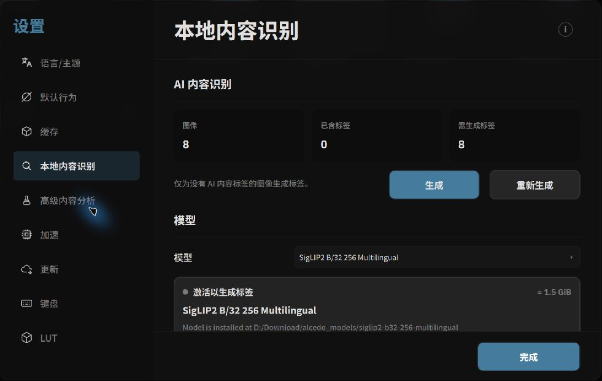

# 本地 AI 模型管理与激活

Alcedo Studio 的本地内容识别与自然语言搜索使用 **CLIP（Contrastive Language-Image Pre-training）** 视觉模型和 **ONNX Runtime**。本页介绍如何下载、管理并激活模型。

---

## 本地模型运作原理

本地视觉模型将导入的图像编码为高维向量（Embeddings）：
- **自动内容标签**：将图像特征向量与预置标签进行余弦相似度匹配，生成内容标签。
- **自然语言语义检索**：当你在搜索框输入“暴风雨中的灯塔”时，文本编码器将查询转换为文本特征向量，并与本地图像向量进行相似度检索。
- **本地推理**：模型在计算机本地运行；下载模型需要网络连接。

---

## 配置模型存储与下载源

点击顶部菜单栏 `设置（Settings）`，在左侧选择 `本地内容识别（Local Content Recognition）`：

*本地模型管理控制台：选择模型、下载源与激活状态*

### 1. 选择视觉模型（Model）
在模型下拉框中选择预训练模型。模型大小和运行需求因所选模型而异，请根据可用存储空间和硬件配置选择。

### 2. 指定下载目录（Download Directory）
点击文件夹图标选择模型权重的保存路径。建议存放在剩余空间充足的固态硬盘分区中。

### 3. 选择镜像加速源（Source）
根据网络环境选择下载源：
- **HF 镜像（HF Mirror）**：Hugging Face 镜像。
- **Hugging Face 官方源**：从 Hugging Face 下载。
- **Sufy CDN**：备用下载源。
- **自定义（Custom）**：填写模型文件的直链地址。

---

## 下载与激活流程

1. **检查状态**：点击 `检查（Check）`。如果本地尚未存在模型文件，状态卡显示红色的 `未下载（Not downloaded）`。
2. **启动下载**：点击 `下载（Download）`。状态卡将显示下载百分比、已下载字节数与预计剩余时间。如遇网络波动，可点击 `取消（Cancel）`，换源后重新点击下载。
3. **激活模型（Activate）**：下载完成后，状态卡会显示灰色的 `激活以生成标签（Activate to generate labels）`。点击 `激活（Activate）` 按钮，系统将模型载入 ONNX Runtime 内存中。
4. **就绪状态**：状态卡显示绿色 `已激活（Active）` 时，模型已激活。

---

## 导入偏好设置（Import Preference）

在 `导入（Import）` 区块中，你可以设定新照片导入图库时的自动化行为：
- **总是询问（Always Ask，默认）**：每次导入时弹出轻量提示框，由你决定本次是否执行 AI 识别。
- **总是生成（Always）**：所有新导入的照片自动进入后台识别流水线并生成标签。
- **总是跳过（Always Skip）**：导入时不触发任何 AI 计算，保留手动打标入口。

---

模型激活完成后，请继续阅读 [AI 自动标签生成](./label-generation.md) 与 [AI 自然语言与多维搜索](./search.md)。
