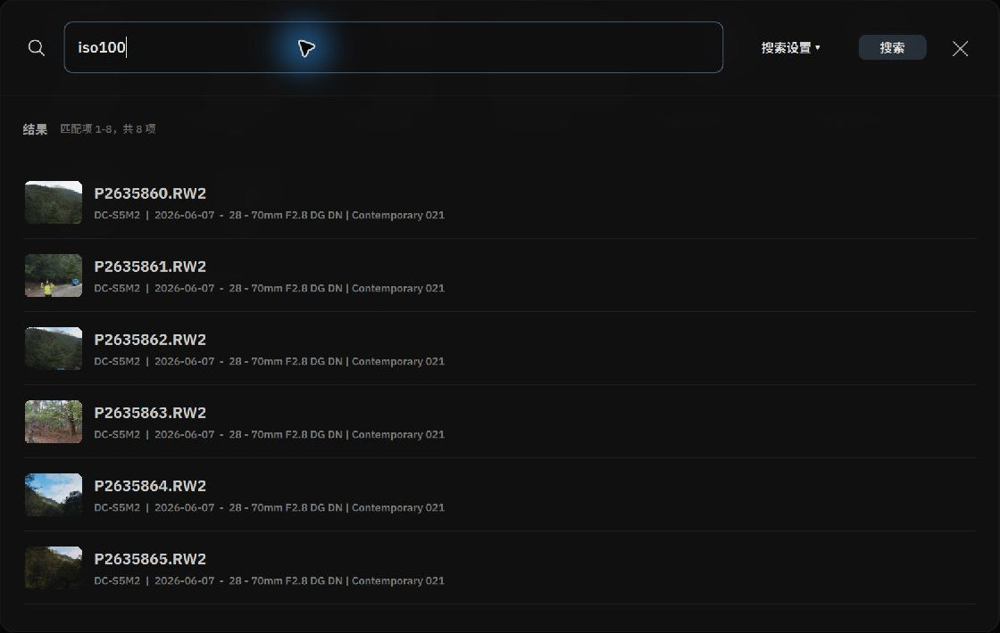
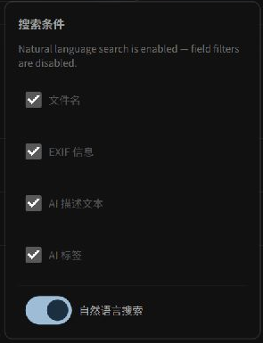

# AI 自然语言与多维结构化搜索

Alcedo Studio 的全局搜索支持 EXIF 等字段查询，也支持使用本地 CLIP 模型进行自然语言语义搜索。

---

## 打开搜索与配置条件

在图库左侧快捷工具栏点击 `搜索（Search）`（或按下快捷键 `Ctrl+F`，macOS 为 `Cmd+F`），即可唤起居中弹出的全局搜索控制台。


*全局搜索结果与相关元数据*

点击搜索框右上角的 `搜索设置 ▾（Search settings ▾）`，可灵活勾选生效字段：
- **文件名（Filename）**：匹配照片文件名关键词。
- **EXIF 信息（EXIF info）**：匹配相机机身、镜头型号与曝光信息。
- **AI 描述文本（AI description）**：匹配保存的 AI 描述文字。
- **AI 标签（AI tags）**：匹配本地视觉模型生成的语义标签。
- **自然语言搜索（Natural language search）**：独立的 AI 语义开关。启用后将直接调取端侧 CLIP 向量模型，按图像内在视觉含义进行智能检索。

---

## 模式 1：自然语言语义搜索（按画面含义检索）


*开启自然语言搜索，使用文字描述查找照片*

勾选 `自然语言搜索（Natural language search）` 后，你无需事先为照片手动添加标签，即可直接描述记忆中的拍摄瞬间：

```text
"海滩上奔跑的金毛犬"
"雪山脚下的红色复古小木屋"
"霓虹灯倒映的雨夜街景"
"阳光穿透森林的光线"
```

### 底层算法机制
按下回车或点击 `搜索` 后，本地文本编码器将查询转换为向量，并与图库中的图像向量进行余弦相似度匹配，按相关度排列结果。

:::note 本地搜索
自然语言搜索使用已激活的本地模型。
:::

---

## 模式 2：EXIF 与参数结构化精准查询

当你需要复盘特定器材表现或特定光线下的作品时，可以在关闭自然语言搜索后，输入简洁的专业参数语法：

| 查询示例 | 检索目标与语法逻辑 |
| --- | --- |
| `2026-06-07` 或 `6月7日` | 检索指定日期拍摄的所有照片 |
| `raw` 或 `dng` / `jpg` | 按文件原始封装格式筛选 |
| `iso800` 或 `iso100` | 检索指定 ISO 感光度拍摄的照片 |
| `f/1.4` 或 `f/2.8` | 检索指定光圈值的照片 |
| `35mm` 或 `85mm` | 检索指定焦距的照片 |
| `iso800 f/2.8 35mm` | **多条件查询**：检索同时满足这三个条件的照片 |

---

## 模式 3：模糊信息匹配

在搜索框中输入“Nikon”、“冰岛”或“Portrait”等词，系统会在选中的字段中进行模糊匹配，包括文件名、EXIF 元数据和保存的 AI 描述文本。

---

## 搜索结果交互与即时定位

1. **实时建议（Suggestions）**：搜索框激活且未输入文字时，列表会自动呈现近期的相机型号、镜头与日期建议，点击即可一秒应用。
2. **应用到相册**：按回车应用搜索后，搜索结果将作为一层高级过滤器注入到图库主网格中。右侧相册检查器顶部会亮起 `搜索筛选（SEARCH FILTER）` 气泡，点击气泡右侧的 `x` 即可随时清除搜索条件并还原全库。
3. **定位照片**：在搜索对话框中单击结果，图库会滚动到对应照片并将其高亮。

有关脚本和 AI 智能体操作，请参阅 [智能体交互与 alcedo-cli 命令行](../automation/cli.md)。
