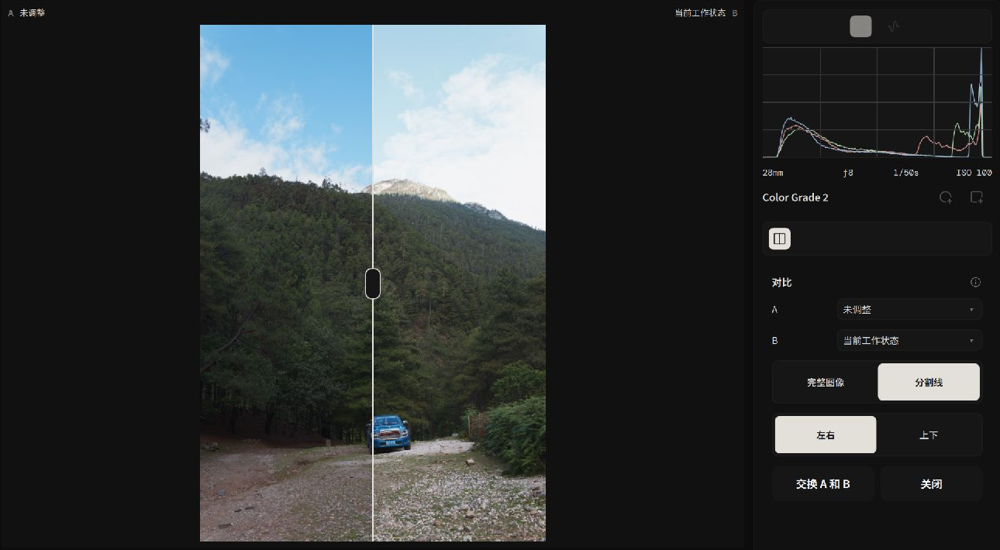
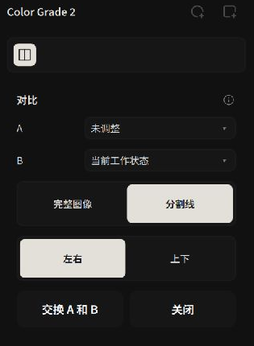

# 修改前后与版本 A/B 对比

Alcedo Studio 的 **A/B 对比**可用于查看调整前后的画面，或比较同一照片的两个版本。

---

## 启动 A/B 对比与指定比对源

你可以在主视口工具栏或版本抽屉中随时唤起对比模式：

*利用交互式分割线直观比对未调色原图与当前成片*

### 两种典型的比对场景
1. **修图前后对比（Before vs. After）**：
   - 点击视口上方的 `对比（Compare）` 按钮。
   - A 侧自动载入“未调整（Unadjusted）”的原始输入基准，B 侧显示当前已调色的最新画面。
2. **多版本分支对比（Version A vs. Version B）**：
   - 打开左侧 `版本（Versions）` 抽屉，点击顶部的 `对比（Compare）`。
   - 在控制栏的 A 与 B 下拉菜单中，任意挑选两个已保存的分支版本（例如将“500T 暖调胶片”与“Tri-X 黑白”并列比对）。

---

## 对比布局模式与交互控制

展开对比后，右侧面板会自动切换至 `对比控制（Comparison Controls）`：

*灵活切换分割线、左右并列或上下并排对比*

| 布局模式 | 显示方式 | 用途 |
| --- | --- | --- |
| **分割线（Divider）** | 拖动分割线查看两侧画面。 | 比较同一位置的细节。 |
| **完整图像：左右（Left / Right）** | 双联并排，左右各自完整渲染整幅画面。 | 宏观评估画面的整体反差、冷暖平衡与视觉重心。 |
| **完整图像：上下（Top / Bottom）** | 针对横画幅或宽银幕照片，上下垂直排列渲染两幅完整画面。 | 风光天地光比及地平线色温比对。 |
| **交换 A 和 B（Swap A and B）** | 对调 A 侧与 B 侧的画面位置。 | 调整两个来源的显示顺序。 |

---

## 对比模式下的状态与安全机制

- **对比期间**：参数调整与历史操作暂时不可用。
- **重试机制**：如因显存分配压力导致渲染未就绪，可随时点击界面上的 `重试（Retry）` 按钮重新触发管线重绘。
- **返回编辑**：点击顶部的 `关闭（Close）` 退出对比模式。

---

有关导出，请参阅 [导出工作流：批处理队列、预设与元数据](../export/workflow.md)。
