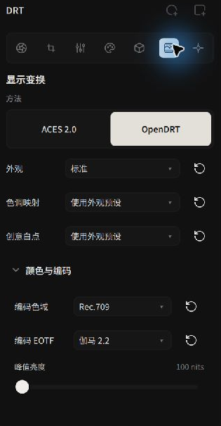
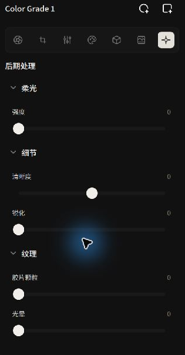

# 显示变换、HDR、示波器与后期质感

**显示变换（Display Transform）** 将场景线性图像转换为显示图像。**后期处理（Post Processing）** 提供柔光、清晰度、锐化等效果

---

## 显示变换（Display Transform）：从场景辐射到屏幕色彩

显示渲染变换（Display Rendering Transform, DRT）将场景线性图像映射到目标显示范围：

*显示变换设置：选择核心映射算法、编码色域与传递函数*

此截图来自 v0.3.3；胶片印片的入口和设置以 v0.3.5 为准

### 核心方法选择
- **ACES 2.0**：使用 ACES 2.0 显示变换。
- **OpenDRT**：使用开源显示变换，可调整色调映射（Tonescale）、暗部耀斑（Flare）、高光去饱和度和创意白点（Creative White）。
- **胶片印片**：选择负片或反转片，模拟印片、负片扫描或看片台效果。详见 [胶片模拟](./film-simulation.md)

### 编码色彩空间与传递函数（EOTF）
根据目标显示设备选择编码色域和 EOTF：

- **Rec.709**：可选 BT.1886、伽马 2.2 或 sRGB
- **P3-D65**：可选伽马 2.2、sRGB 或 ST 2084（PQ）
- **Rec.2020**：可选 ST 2084（PQ）或 HLG

HDR 输出可选 PQ 或 HLG，并按目标显示设备设置峰值亮度。胶片印片的相纸、拷贝片和反转片输出固定为 Rec.709 SDR；负片扫描提供 OpenDRT 和编码设置

---

## 实时 GPU 示波器：波形图与直方图

直方图和波形图可用于检查图像的亮度分布：

- **直方图（Histogram）**：
  位于右侧面板顶部。展示红、绿、蓝三通道的像素亮度频次分布。通过观察左右两端是否顶格，直观判断暗部是否死黑截断或高光是否彻底溢出。
- **波形图（Waveform）**：
  横轴与照片的水平空间位置严格一一对应，纵轴代表 0–100 IRE 亮度等级。能够精确指出画面某个具体区域（如左侧阳光穿透的云层、右侧背阴的人物面部）所处的实际亮度电平，极其适合把控人像肤色基准（通常落在 40–70 IRE 区间）。

---

## 屏幕后期质感（Post Processing）

后期处理提供柔光、清晰度、锐化、颗粒和光晕等控制。选择胶片印片时，请在 **显示变换 → 风格** 中调整颗粒、画幅和光晕

*后期处理：胶片柔光、清晰度、锐化与光晕*

| 模块 | 物理光学模拟 | 调校建议与视觉效果 |
| --- | --- | --- |
| **柔光（Diffusion）** | 模拟光学散射。 | 在高光周围添加扩散效果，并使画面变柔和。 |
| **清晰度（Clarity）** | 针对中间调高频微反差的自适应增强。 | 提亮建筑物岩石纹理或雕塑线条；适度降低可起到自然的人像轻度磨皮效果。 |
| **锐化（Sharpening）** | 边缘高频卷积增强，附带半径与阈值控制。 | 调整边缘和细节的清晰度。 |
| **胶片颗粒（Film Grain）** | 调整画面颗粒和画幅。 | 在 ACES 2.0 或 OpenDRT 方法下使用后期处理中的控制。 |
| **光晕（Halation）** | 调整强光周围的红色光晕。 | 在 ACES 2.0 或 OpenDRT 方法下使用后期处理中的控制。 |

---

有关调整前后和版本对比，请参阅 [修改前后与版本对比](./comparison.md)。
