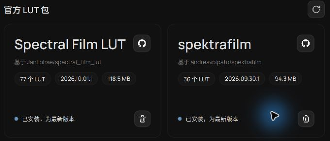
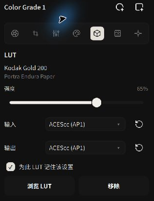
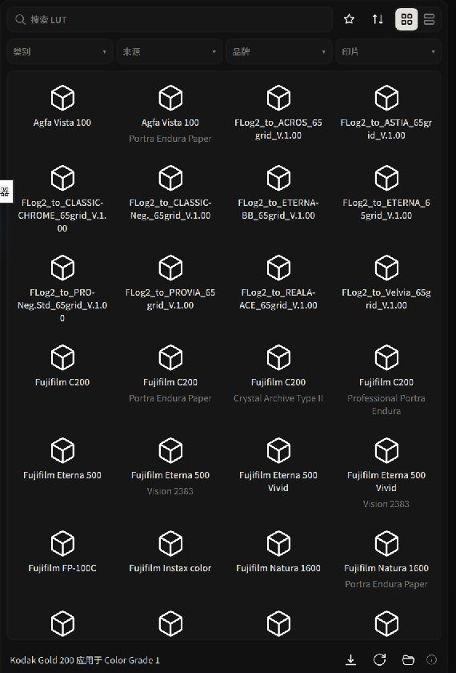

# 3D LUT 库、胶片模拟与色彩空间编码

3D LUT（三维颜色查找表）用于在调色节点中应用颜色变换。Alcedo Studio 支持官方 LUT 包和用户导入的 `.cube` 文件，并可设置 LUT 的输入编码、输出编码和强度

v0.3.5 还提供 **显示变换 → 胶片印片**，可选择胶片、印片材料与扫描设置。详见 [胶片模拟](./film-simulation.md)

---

## 官方胶片包与自定义 LUT 库管理

官方胶片模拟 LUT 包可在设置中下载，安装时会校验数字签名：


*设置中的官方胶片 LUT 包管理器*

### 1. 下载与安装官方胶片模拟包
1. 进入顶部 `设置（Settings） → LUT（LUTs）` 面板。
2. 在 `官方 LUT 包（Official LUT Packages）` 列表中选择需要的胶片模拟包，例如 Kodak Portra、Fujifilm Pro / Superia、CineStill 或 Kodachrome。
3. 点击 `下载（Download）`。系统会在后台完成下载、数字签名完整性校验并自动解压部署。
4. 部署完成后，状态标记为 `已安装（Installed）`。后续如有新版色彩优化，可在此直接一键点击更新或修复。

### 2. 导入第三方与自定义 `.cube` 文件
如果你拥有调色师定制或商业购买的 `.cube` 查找表：
1. 在 `设置 → LUT` 中查看当前的 `LUT 库路径（LUT library path）`。
2. 点击 `在文件资源管理器中打开`（macOS 为 `在访达中打开`），将你的 `.cube` 文件或文件夹放入用户目录中。
3. 点击 `刷新（Refresh）`，自定义 LUT 将自动整理并呈现在浏览器的 `用户（User）` 分类下。

---

## LUT 输入与输出色彩空间编码

LUT 对输入和输出编码可能有特定要求。编码不匹配时，画面的亮度和色彩可能与预期不同。每个调色节点提供 **输入编码（Input Encoding）** 与 **输出编码（Output Encoding）**设置：

```text
[ 场景线性色彩 (ACEScg) ]
           │
           ▼
[ 1. 输入色彩转换 ] ──▶ 将场景色彩转换为 LUT 所期望的色彩空间 (如 ARRI LogC3, Sony S-Log3, ACEScc)
           │
           ▼
[ 2. 3D LUT 三维变换 ] ──▶ 应用 LUT 定义的颜色变换
           │
           ▼
[ 3. 输出色彩转换 ] ──▶ 将 LUT 的输出还原回 ACES 场景色彩流水线
           │
           ▼
[ 后续调色与显示变换 ]
```


*在调色面板中设置精确的输入与输出色彩编码*

### 常见编码配置指南
- **官方胶片模拟包**：默认采用 **ACEScc** 输入与输出。
- **电影机 Log LUT（如 ARRI LogC3、Sony S-Log3、Canon Log 2）**：
  - **输入编码（Input）**：选择对应的相机 Log 曲线（如 `ARRI LogC3`）。
  - **输出编码（Output）**：按照 LUT 附带的说明选择。
- **其他 LUT**：按照 LUT 附带的说明选择输入和输出编码；输入和输出编码可能不同。
- **为此 LUT 记住该设置（Remember for this LUT）**：
  勾选此项后，系统会在本地数据库中牢牢记住该 LUT 专用的输入/输出色彩配对。下次再次调用该 LUT 时，自动装载正确的色彩空间，彻底免除重复配置的烦恼。

:::caution 强度不能掩盖编码错误
如果加载 LUT 后画面反差异常，请先核对 LUT 要求的输入与输出编码，再调整强度
:::

---

## 浏览、应用与强度混合

进入编辑器，在左侧工具轨打开 `LUT（LUTs）` 抽屉：


*可视化 LUT 浏览器：支持分类搜索、收藏与缩略图预览*

1. **精准检索**：
   - 可按类别（Category：黑白、彩色负片、反转片、电影卷）、来源（Source）或品牌（Brand）进行筛选。
   - 在搜索框输入关键词（如“Portra 400”、“5207”）快速定位。
   - 点击星标按钮将常用 LUT 加入收藏。
2. **挂载与应用**：
   - 确保当前激活了正确的调色节点，在网格或列表中单击某个 LUT，视口画面将即刻呈现色彩质感；再次点击已选中项可安全卸载。
3. **混合强度（Strength）**：
   - 在右侧 LUT 面板中拖动 `强度` 滑块（0%–100%），调整 LUT 应用前后结果的线性混合比例。

---

有关显示输出和后期处理，请参阅 [显示变换、HDR 与后期质感](./display-and-effects.md)。
