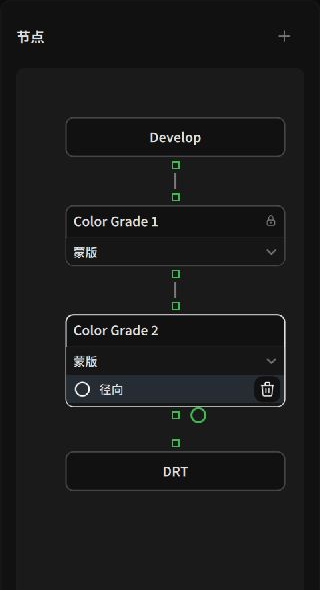
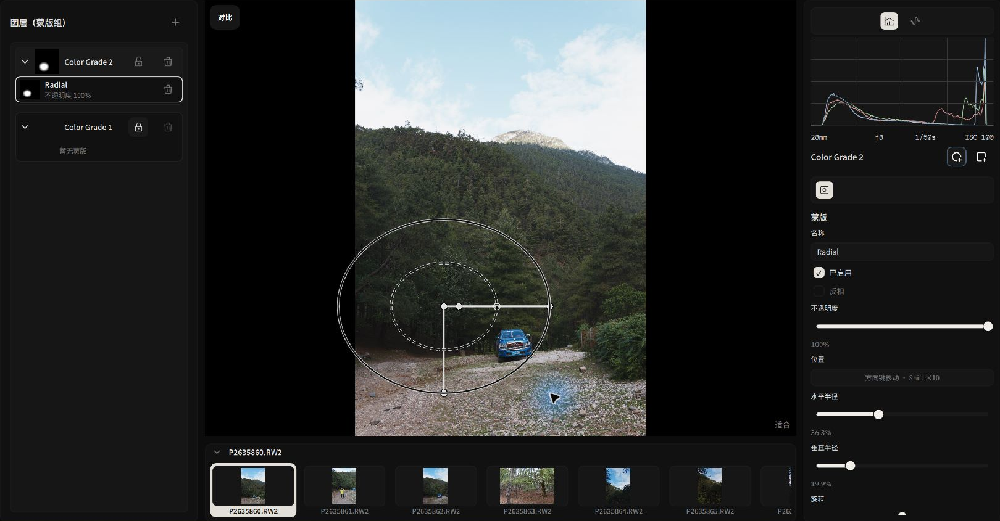
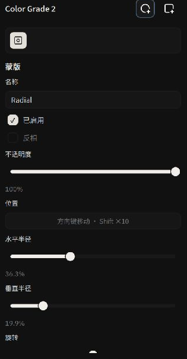

# 调色节点、图层与局部蒙版

Alcedo Studio 使用**节点式调色流水线（Node-Based Color Pipeline）**和**蒙版组（Mask Groups）**。你可以使用多个调色节点，并通过蒙版限制节点调整的范围。

---

## 节点处理顺序

调色节点按顺序组成处理链，例如：

```text
[ 输入解码 (RAW/位图) ] 
       │ 场景线性色彩流 (ACEScg)
       ▼
[ Develop 基础显影节点 ] ────────── (负责全局曝光、相机白平衡基准与基础动态范围)
       │
[ Color Grade 1: 主体提亮 ] ────── (挂载径向蒙版：聚焦人物面部，适度提亮并加强眼部微反差)
       │
[ Color Grade 2: 天空压暗 ] ────── (挂载线性渐变蒙版：压暗云层过曝区域，加入深邃青蓝色调)
       │
[ Color Grade 3: 整体风格胶片 ] ── (全局挂载 3D 胶片 LUT 与 Lift/Gamma/Gain 色调分离)
       │
[ Display Transform 显示变换 ] ─── (通过 ACES 2.0 / OpenDRT 将场景线性映射至显示器色域)
       │
[ Post Processing 屏幕后期 ] ───── (整图添加胶片柔光、自然颗粒与暗角光晕)
```

每个 **Color Grade 调色节点**都有自己的 `色调（Tone）`、`外观（Look）`、`LUT` 和 `局部蒙版（Masks）`设置。

---

## 节点图（Nodes）与图层组（Mask Groups）双视角

左侧工具轨提供两种操作视图：


*节点视图：直观查看从基础输入到显示输出的完整拓扑链路*

### 1. 节点（Nodes）拓扑视图
- **添加调色节点**：点击 `添加色彩分级（Add Color Grade）` 即可向处理链中插入新节点。
- **自定义命名**：养成按调色意图命名的好习惯（如“基础影调”、“主体面光”、“冷调环境”）。
- **选择编辑目标**：在节点画布中单选某个节点，右侧调整面板的标题将同步显示该节点名称，确保所有参数调节均精准作用于目标节点。

### 2. 图层与蒙版组（Mask Groups）视图
如果你更习惯 Photoshop 或 Capture One 的图层工作流，可以打开 `图层（Mask Groups）` 面板：
- 每个调色节点对应一个图层卡片，卡片内直观显示当前挂载的蒙版缩略图与不透明度滑块。
- 拖动图层可以调整处理顺序，改变节点对画面的作用顺序。

:::tip 锁定节点保护机制
第一个基础调色节点默认包含全图的基础基准。在 `设置（Settings） → 默认行为（Default Behavior）` 中，默认推荐勾选“新建图层后绘制”。这样当你在画面上尝试圈选局部时，系统会自动为你新建一个独立的调色层，避免将全图的基础曝光错误限制在局部圈子中。
:::

---

## 局部蒙版工具与交互手柄

为调色节点挂载蒙版后，右侧会自动滑出上下文 **蒙版（Mask）** 参数页，同时主画布上会呈现高精度的交互式几何控制柄。


*利用画布屏幕手柄交互式控制径向蒙版的羽化与位置*

### 1. 径向蒙版（Radial Mask）
径向蒙版可用于调整画面中的椭圆区域：


*径向蒙版的详细几何参数调节*

1. **选择工具并绘制**：在选定的调色节点上添加径向蒙版，在画面主体位置点击并拖动，拉伸出一个椭圆选区。
2. **交互控制手柄**：
   - **中心锚点**：拖动中心点移动蒙版位置（支持键盘方向键微调，按住 `Shift` 加速移动）。
   - **内外羽化环**：内圈代表 100% 作用区域，外圈代表衰减边缘。调整两圈间距可以改变过渡宽度。
   - **旋转手柄**：旋转椭圆的长短轴。
3. **反相与不透明度**：
   - 勾选 `反相（Invert）`：反转蒙版的作用区域。
   - `不透明度（Opacity）`：0%–100% 整体衰减当前蒙版对该节点调色效果的施加权重。

### 2. 线性渐变蒙版（Linear Gradient Mask）：平衡天地光比
线性渐变蒙版可用于分别调整天空和地面，例如：

1. **添加渐变蒙版**：在调色节点上添加线性渐变蒙版，从天空顶端向地平线方向拖拽出渐变线。
2. **渐变过渡控制**：
   - 旋转渐变轴，使其与山脊线或地平线对齐。
   - 调整 **过渡宽度（Transition Width）**，控制蒙版的渐变范围。
3. **调整参数**：在当前节点中调整 `曝光`、`高光`和白平衡，并根据画面检查蒙版覆盖范围。

---

有关节点中的调整参数，请参阅 [影调、曲线与色彩控制](./tone-and-color.md)。
