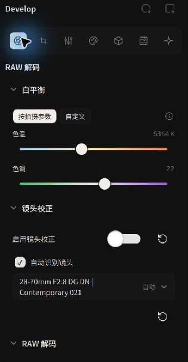
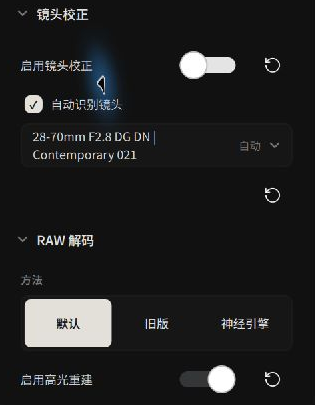
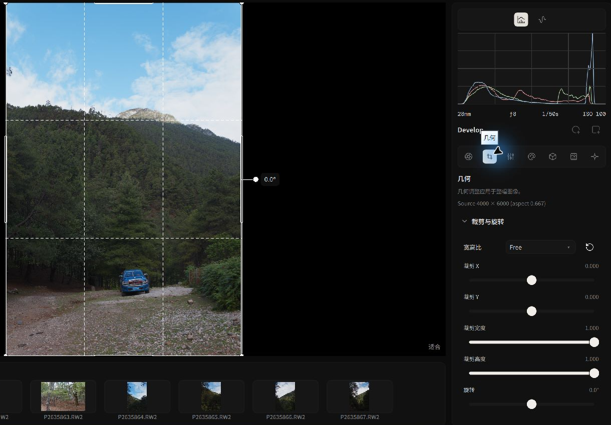

# 输入解码、色彩配置与几何构图

本页介绍 **RAW 解码、位图输入色彩**以及**裁剪与旋转**。

---

## RAW 照片：传感器级白平衡与去马赛克

使用彩色滤镜阵列（Color Filter Array, CFA）的相机记录的 RAW 数据需要经过解码和去马赛克，才能生成彩色图像。

*RAW 解码控制台：相机白平衡与镜头光学校准*

### 1. 相机白平衡（Camera White Balance）
- **拍摄时白平衡（As Shot）**：软件读取相机记录的白平衡信息，并在 RAW 解码时应用。
- **与外观白平衡的区别**：RAW 白平衡在解码阶段应用；[外观（Look）面板](../editing/tone-and-color.md)中的 CAT02 白平衡在调色节点中应用。

### 2. 去马赛克算法（Demosaicing Method）
去马赛克决定了从单色马赛克阵列重构全彩三通道像素的锐度与纯净度：
- **RCD 算法（Ratio-based Corrected Demosaicing）**：Bayer 传感器的默认算法。
- **神经网络去马赛克（Neural Engine）**：使用 GPU 加速的神经网络处理 Bayer 与 Fujifilm X-Trans 传感器数据。
- **X-Trans**：针对富士 6×6 滤镜阵列使用神经网络分支。

### 3. 高光重建（Highlight Reconstruction）
部分颜色通道发生高光截断时，勾选 `启用高光重建` 可使用未截断通道的信息估计缺失数据。结果取决于源文件和截断情况。

### 4. 镜头光学校正（Lens Calibration）
Alcedo Studio 深度集成了 Lensfun 镜头数据库：
- **全自动识别**：根据照片 EXIF 自动匹配相机卡口与具体镜头型号。
- **镜头校正**：使用镜头配置文件校正畸变、暗角和横向色差。
- **手动覆盖**：老镜头或转接镜头如果未写入完整元数据，可点击选择器按品牌手动挑选镜头型号。

---

## 位图输入色彩空间（Raster Color Management）

Alcedo Studio 支持导入 JPEG、TIFF、PNG 以及 OpenEXR。打开非 RAW 照片时，右侧会自动呈现 `输入色彩（Input Color） / 输入配置文件（Input Profile）`：

*非 RAW 图像的色彩空间自动匹配与解析*

- **自动元数据检测（Auto metadata）**：默认选项。引擎自动解析位图内嵌的 ICC 配置文件、PNG 色度块或 OpenEXR 线性原色。
- **转换至场景线性空间**：根据输入色彩配置将位图转换到 ACES 场景线性空间，以便使用调色节点和显示变换。
- **HDR 位图支持**：针对包含 PQ / HLG 曲线的 10 位以上 HEIF/TIFF 或 16/32 位半浮点 OpenEXR，系统会自动标记为 HDR 输入并保留高动态范围数据。

---

## 几何构图：裁剪与旋转

裁剪和旋转设置画面的构图，可以在编辑历史中撤销或重新调整。

*利用网格与智能边界锁定进行构图*

1. **构图宽高比（Aspect Ratio）**：
   - 包含标准画幅比例：`原始（Original）`、`1:1`、`4:5`（社交平台竖图）、`16:9`、`3:2` 等。
   - 勾选锁定比例后，拖动裁剪框角点将严格维持几何长宽比；点击自定义比例可按需设定特殊的画幅。
2. **交互裁剪手柄**：
   - 画布上提供三等分参考辅助线（Rule of Thirds）。
   - 直接在画面中拖拽四角或边框改变构图，也可以在右侧面板通过精确像素数值调整。
3. **水平校准与旋转（Rotation）**：
   - 拖动旋转滑块校准倾斜的地平线。
   - **边界限制**：旋转时，裁剪矩形会自动调整以保持在图像边界内。
4. **重置与历史**：
   - 点击 `重置裁剪和旋转（Reset crop and rotation）` 即可恢复满幅画面。

---

有关节点和蒙版，请参阅 [调色节点、图层与局部蒙版](./nodes-and-masks.md)。
