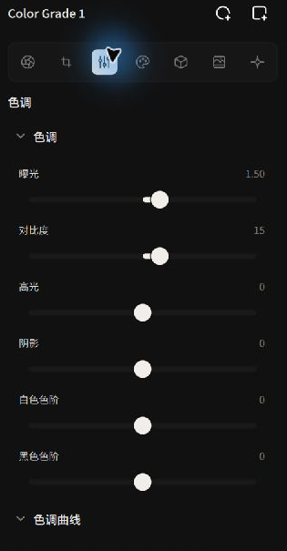
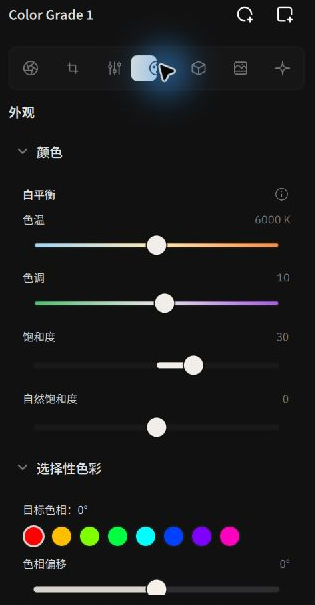

# 影调、曲线与色彩控制

Alcedo Studio 的调色管线使用**场景线性宽色域空间（ACEScg）**。本页介绍影调、白平衡、饱和度、选择性色彩和色轮控制。

---

## 基础色调（Tone）：场景线性曝光与动态范围

在选定的调色节点下打开 `色调（Tone）` 面板。控制面板遵循从整体曝光到局部反差的专业调校逻辑：


*通过物理曝光与高光/阴影双边色调映射重塑光影层次*

| 控件 | 物理与算法原理 | 实际调校建议 |
| --- | --- | --- |
| **曝光（Exposure）** | 以曝光值（EV / 档）为单位，对场景线性值应用 `2^(ΔEV)` 缩放。 | 调整全图曝光，并观察直方图的高光端。 |
| **对比度（Contrast）** | 围绕 18% 中灰（Middle Gray, 0.18）锚点调整反差，使用色相保持（Hue Constancy）算法。 | 按画面需要调整全局反差。 |
| **高光（Highlights）** | 基于双边边缘保持滤波（Bilateral Filter）的局部高光压缩。 | 调整天空和反光等亮部区域，并留意边缘过渡。 |
| **阴影（Shadows）** | 针对暗部梯度的局部提亮。 | 提亮逆光下的人脸或背阴建筑细节，配合波形图观察暗部杂讯与纯黑底线。 |
| **白色色阶（Whites） / 黑色色阶（Blacks）** | 调整画面的白色和黑色色阶。 | 观察直方图并调整亮部和暗部。 |
| **色调曲线（Tone Curve）** | 交互式多点三次样条曲线（Cubic Spline）。 | 左键单击增加点并拖动，右键单击删除控制点，双击曲线区域重置。可用于调整中间调对比度。 |

:::tip 交互快捷恢复
面板上的所有滑块均支持**双击滑块手柄**瞬间恢复默认推荐值。
:::

---

## 核心色彩科学：两种白平衡的区别

`RAW 解码（RAW Decode）` 与 `外观（Look）` 中各有一套白平衡，作用阶段和方法不同：


*在 Look 面板中运用 CAT02 创意白平衡与色相控制*

```text
[ RAW 白平衡 ] ──▶ 在 RAW 解码阶段调整通道增益
[ CAT02 外观白平衡 ] ──▶ 在调色节点中调整白平衡
```

1. **RAW 解码白平衡（Camera WB）**：
   - **作用阶段**：位于去马赛克插值阶段之前。
   - **方法**：在解码阶段对颜色通道应用白平衡增益。
   - **用途**：调整 RAW 图像的白平衡。
2. **外观白平衡（Look WB）**：
   - **作用阶段**：位于调色节点内部的场景线性色彩空间中。
   - **方法**：使用 **CAT02（CIECAM02 色适应变换）**矩阵调整色彩。
   - **用途**：调整节点中的色温和色调，例如配合蒙版调整主体或背景。该控制适用于 RAW 和 JPEG/TIFF 位图。

---

## 饱和度与选择性色彩（Selective Color）

在 `外观（Look）` 面板中，你可以精确分离并重塑画面的色彩饱和度：

- **自然饱和度（Vibrance）**：调整色彩饱和度，对饱和度较低的颜色作用更明显。
- **饱和度（Saturation）**：全色相通道的线性彩度缩放。

### 8 色选择性色彩分离
展开 `选择性色彩（Selective Color）`，可对红、橙、黄、绿、青、蓝、紫、洋红 8 种主要色相进行三维几何调整：

1. **目标色相（Target Hue）**：选择需要微调的色彩族（例如选择“绿色”调整风光草木，或选择“橙色”调整东方人肤色）。
2. **色相偏移（Hue Shift）**：旋转色彩走向（如将偏黄的枯草转向深翠绿，或将日落金黄微调向晚霞粉橙）。
3. **明度（Lightness）**：局部升降特定颜色的反射亮度（如压暗青蓝色提升晴空饱和厚重感）。
4. **彩度（Chroma）**：单独强化或褪去该颜色的纯度。
5. **色相平滑度（Hue Smoothness）**：控制与邻近色相之间的过渡宽度。

---

## 三路色轮（Lift / Gamma / Gain Color Wheels）

三个色轮用于分别调整不同影调区域的颜色：

- **Lift（阴影 / 托底）**：主要作用于画面暗部与黑阶。通常向青蓝色偏移以压实阴影质感。
- **Gamma（中间调 / 幂率）**：覆盖大部分皮肤与主体反光，直接奠定画面的整体情绪基调。
- **Gain（高光 / 斜率）**：主要作用于亮部高光与反光点。向暖黄色或金橙色偏移，形成经典冷暖互补光比。
- **Master 亮度滚轮**：每个色盘下方配有独立的主控亮度滚轮，无需破坏已调好的色盘偏向即可单独微调该分区的明度权重。点击 `重置色轮（Reset wheels）` 可一键恢复初始状态。

---

有关 LUT 的使用，请参阅 [3D LUT 库与色彩空间匹配](./lut-library.md)。
