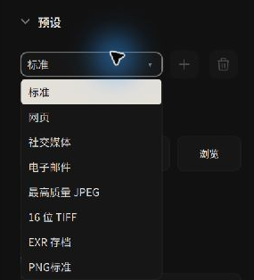
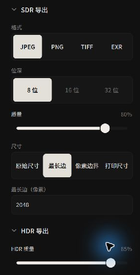
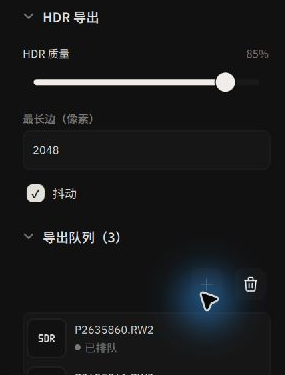
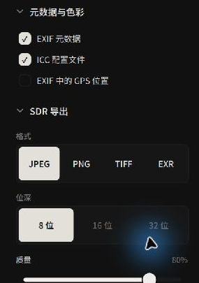

# 导出工作流：批处理队列、预设与元数据

Alcedo Studio 将编辑参数保存在项目数据库中。**导出（Export）**将编辑结果渲染为图像文件。

---

## 导出工作流概览

导出队列在后台处理照片，期间可以继续浏览或编辑其他照片：

```text
[ 图库 / 编辑器选片 ] ──▶ [ 加入导出队列 (Add to Queue) ]
                                   │
[ 配置输出预设 / 命名模式 / 尺寸 ] ◀┘
       │
       ▼
[ 后台 GPU 批量并发渲染 ] ──▶ [ 输出磁盘成品 (JPEG / 16-bit TIFF / Ultra HDR / OpenEXR) ]
```

---

## 1. 将照片添加至导出队列

1. 在 `图库（Library）` 或编辑器底部的胶片带中，选中需要导出的单张或多张照片。
2. 点击右侧检查器顶部的 `加入队列（Add to Queue）` 按钮（或点击导出队列列表上的 `+` 号）。
3. 切换至 `导出（Export）` 检查器面板，即可查看已排队的照片数量与源文件名列表。
4. 清空队列只会移除本次待渲染任务，绝不会删除或改变图库中的照片。

---

## 2. 导出预设（Export Presets）

右侧检查器提供内置预设，用于配置格式、色彩空间、压缩率与尺寸：


*选择内置专业导出预设或管理自定义方案*

| 预设名称 | 核心配置与参数规格 | 适用场景 |
| --- | --- | --- |
| **网页（Web）** | JPEG 质量 80、最长边缩放至 2048px、转换至 sRGB 色域、**默认自动剥除 GPS 经纬度**。 | 网页博客、社交平台分享，兼顾加载速度与隐私安全。 |
| **社交媒体（Social Media）** | JPEG 质量 90、边界锁定在 1080 × 1350px 竖构图范围内、sRGB 色域、自动关闭 GPS。 | Instagram、小红书等移动端图片流发布。 |
| **电子邮件（Email）** | JPEG 质量 75、最长边 1280px、轻量化文件体积。 | 邮件附件速递或快速初审小样。 |
| **最高质量 JPEG** | 原始分辨率、JPEG 质量 100、嵌入 EXIF 与 ICC 色彩配置文件。 | 照片交付、数码相框展示。 |
| **16 位 TIFF** | 原始分辨率、16 位深度、无损 ZIP 压缩。 | 打印、印刷打样。 |
| **EXR 存档（EXR Archive）** | 原始分辨率、16 位半浮点（Half-Float）OpenEXR 线性数据。 | 影视后期、VFX 合成与母版长期数字存档。 |

### 自定义用户预设
修改格式、尺寸或命名规则后，预设下拉框会显示为 `自定义（Custom）`。输入预设名称并点击保存，可将参数保存为本机用户预设；点击垃圾桶图标可删除用户预设。

---

## 3. 动态文件名命名模式（File Naming）

文件命名支持变量。面板下方的 **示例文件名（Example）**显示命名模式的结果，供导出前检查：

```text
{date:yyyy-MM-dd}_{source}_{sequence:0001}
```

常用支持的动态宏字段包括：
- `{source}`：原始照片文件名（不含扩展名）。
- `{date:yyyy-MM-dd}`：格式化拍摄日期（支持 `yyyy` 年、`MM` 月、`dd` 日、`HH` 时等）。
- `{sequence:0001}`：自增序号（格式化冒号后指定补零位数，如 `0001`、`001`）。
- **元数据宏**：`{camera_model}`（相机机身）、`{lens}`（镜头型号）、`{iso}`、`{aperture}`（光圈）、`{shutter}`（快门速度）、`{focal_length}`（焦距）、`{rating}`（星级评分）。

---

## 4. 输出格式、位深与尺寸重采样


*精细调控输出位深、压缩格式与物理重采样尺寸*

### 格式与位深矩阵
- **JPEG**：8 位标准压缩，可精细拖动 1–100 质量滑块。
- **PNG**：支持 8 位与 16 位，可配置压缩级别（0–9）。
- **TIFF**：支持 8 位、16 位与 32 位浮点，支持 `无压缩（None）`、`LZW` 与 `ZIP` 压缩。
- **OpenEXR**：支持 16 位半浮点与 32 位全浮点格式。

### 尺寸模式（Sizing Mode）
- **原始尺寸（Original）**：按图像裁切后的满像素分辨率导出。
- **最长边（Long Edge）**：按指定像素等比例缩放最长的一条边（横图按宽度、竖图按高度缩放）。
- **像素边界（Bounds）**：指定最大宽和最大高（如 1920 × 1080），系统将图像等比例完整容纳在边界框内部，绝不变形拉伸。
- **打印尺寸（Print）**：指定物理尺寸（毫米 mm / 厘米 cm / 英寸 in）与目标打印分辨率（如 300 DPI），底层自动换算对应的物理像素。

---

## 5. Ultra HDR 导出

Alcedo Studio 支持 **Ultra HDR JPEG** 导出：


*配置 Ultra HDR 增益图、HDR 质量与最长边*

- **增益图（Gain Map）**：Ultra HDR JPEG 包含 SDR 图像和增益图。支持 Ultra HDR 的查看软件和 HDR 显示设备可以使用增益图显示 HDR 效果；其他查看方式可显示 SDR 图像。
- **HDR 独立配置**：可单独调节 HDR 质量、抖动（Dithering）以及 HDR 最长边（范围 256–8192 像素）。

---

## 6. 元数据、色彩配置文件与隐私安全


*独立控制 GPS 与 EXIF 写入*

- **EXIF 元数据（EXIF metadata）**：控制是否将光圈、快门、相机机身与镜头型号写入成片。
- **ICC 配置文件（ICC profile）**：将色彩配置文件（如 sRGB、Display P3）嵌入图像，供支持色彩管理的软件读取。
- **EXIF 中的 GPS 位置（GPS location in EXIF）**：  
  使用独立开关控制是否将 GPS 位置写入导出文件。其他 EXIF 信息是否写入取决于 EXIF 设置。

---

## 7. 启动渲染与完成监控

1. 确认目标位置（Destination）文件夹无误，亦可勾选 `放入子文件夹（Put in Subfolder）`。
2. 点击底部的 `导出 … 个文件（Export … Files）` 蓝色按钮。
3. 队列中各条目将依次流转：`已排队（Queued）` → `正在导出（Exporting）` → `完成（Done）`。
4. 若出现失败项，查看显示的错误信息。导出完成后，可在目标目录检查文件。
