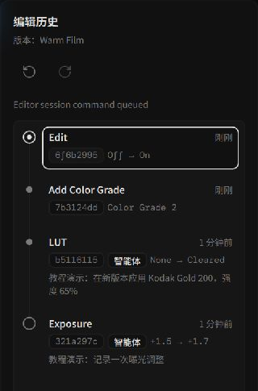
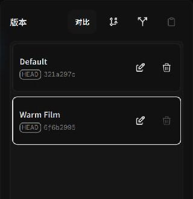

# 编辑历史、分支版本与参数复用

Alcedo Studio 使用**有向无环图（DAG）提交与分支**记录编辑历史。你可以撤销或重做操作，也可以为同一张照片创建多个版本。

---

## 历史（History）：原子提交与撤销重做

*查看线性历史步骤与参数提交记录*

### 1. 提交生成逻辑
- **交互预览**：拖动滑块时，视口会预览调整效果。
- **释放即提交（Commit on Pointer Release）**：当你松开鼠标或结束数值输入时，系统会自动将当前的修改打包为一次原子事务提交（Transaction Commit），追加到历史记录中。裁剪、蒙版增删、白平衡微调以及 LUT 切换均遵循此机制。
- **非破坏性撤销**：按 `Ctrl+Z`（macOS 为 `Cmd+Z`）撤销，`Ctrl+Shift+Z` / `Ctrl+Y` 重做。点击左侧 `历史（History）` 面板中的任意步骤，视口即可瞬间定位到该时刻的画面状态。

### 2. 智能体与自动化标记
通过 `alcedo-cli` 或 AI 智能体执行的调色指令，会在历史列表中附带专属图标与编辑理由注释，方便你随时复查或单独回滚机器人的调整。

---

## 版本（Versions）：多重调色分支探索

**版本（Versions）**功能可以为同一张照片保存多套调整：

*为同一张照片管理多套独立的风格分支*

### 核心分支操作
- **从当前提交创建分支（Branch from current commit）**：  
  在已有调色的基础上建立新分支。例如：在完成基础影调后创建分支，一条分支用于“暖调电影胶片”，另一条分支用于“高反差黑白”。
- **从根节点创建新版本（Fork new version from root）**：  
  从 RAW 导入的最原始状态建立分支，适合推翻当前所有调整、从零开启全新构思。
- **切换与保存**：
  单击版本列表中的任意名称，引擎自动检出（Checkout）该分支并在视口中实时重建色彩管线。系统会在切换前自动确保所有未保存提交完整持久化。
- **重命名与安全删除**：  
  双击版本名称即可重命名（如“客户初审版”、“终稿印刷版”）。当前处于激活状态的版本受安全保护不可删除，需先切换至其他版本后方可移除废弃分支。

---

## 选择性复制与批量粘贴（Adjustment Transfer）

使用**选择性参数复制与粘贴**，可以将所选调整从一张照片应用到其他照片。裁剪、曝光等参数也可以被选择，因此粘贴前应检查所选模块。

*选择性勾选需复制的参数模块*

### 操作步骤
1. **复制来源参数**：  
   在已调色照片上右键，选择 `复制调整…（Copy Adjustments…）`。
2. **选择来源版本与模块**：  
   在弹出的配置对话框中，选择提取参数的来源版本（Version），并按需精准勾选：
   - **基础输入与几何**：RAW 相机白平衡、去马赛克、镜头校正、裁剪与旋转。
   - **调色节点（Color Grade Nodes）**：色调（曝光、对比度、曲线）、创意外观（CAT02 创意白平衡、饱和度、色轮）、3D LUT 及输入输出色彩编码。
   - **全局渲染**：显示变换（ACES 2.0 / OpenDRT）及屏幕后期处理（柔光、颗粒、锐化）。
3. **批量选择目标照片**：  
   在图库或底部胶片带中多选一张或多张目标照片，右键选择 `粘贴调整…（Paste Adjustments…）`。
4. **确认粘贴规则**：  
   再次核对本次要注入的参数范围，点击确认。系统将在后台异步批量完成处理。

### 粘贴后的版本
- **新建分支版本**：粘贴操作会为目标照片创建分支版本，保留原有历史版本。
- **未选择的参数**：未选择的参数保留目标照片原有的设置。粘贴前请检查各模块的选择范围。

---

有关图库管理，请参阅 [图库与资产管理](../library/import-and-organize.md)。
