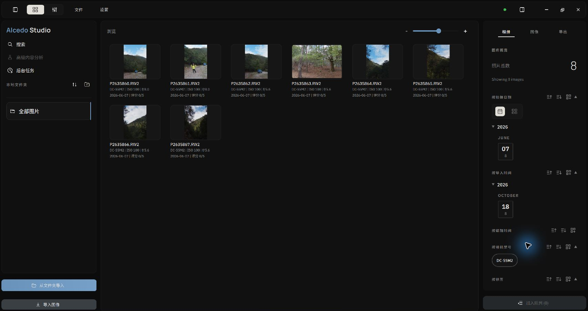

# 图库管理：导入、集合、评分与多维组织

Alcedo Studio 的图库（Library）使用嵌入式 **DuckDB 数据库（Sleeve 引擎）**记录照片引用、元数据和编辑信息。

---

## 照片导入：精细控制与批量扫描

Alcedo Studio 提供两种灵活的导入路径，适应不同的采风归档场景：

```text
[ 硬盘源文件 ] ──┬──▶ [ 导入图像 (直接选文件) ] ───────────┐
                 └──▶ [ 从文件夹导入 (递归扫描 + 格式筛选) ] ┴─▶ [ DuckDB 元数据建库与缩略图缓存 ]
```

:::important 源文件与存储卡
导入时，Alcedo Studio 在 `.alcd` 项目中记录照片源文件的**绝对路径**，不会复制、移动或修改照片。

建议先自行将照片从存储卡复制到电脑或其他用于长期保存的存储设备，再从该位置导入。若直接导入存储卡中的照片，需要读取原文件时，速度可能受存储卡和读卡器的 I/O 性能影响。移除存储卡或改变其挂载路径后，项目将无法在原路径找到源文件。
:::

### 1. 导入图像（Import Images）
点击左侧面板的 `导入图像`，调用系统原生文件选择器。适合导入单张或少量已挑选好的文件。

### 2. 从文件夹导入（Import From Folder）
文件夹导入会扫描所选文件夹及其子文件夹：
1. 选取目标目录后，系统将快速扫描该文件夹及其所有子目录。
2. 弹出导入确认面板，按真实格式分类汇总文件数量：
   - **RAW**：主流相机原始数据（Sony `.ARW`、Canon `.CR2/.CR3`、Nikon `.NEF` 含 HE/HE*、Fujifilm `.RAF`、Leica / 各种 `.DNG` 等）。
   - **位图图像**：JPEG、TIFF（8/16/32 位）、PNG 与 OpenEXR。
   - **其他文件**：非图像文件仅统计展示，自动剔除。
3. **按格式过滤**：勾选要导入的格式。例如，RAW 和 JPEG 同时拍摄时，可以只选择 RAW。
4. 点击 `导入 … 个文件`，引擎将在后台并发提取 EXIF 元数据并写入 DuckDB，右上方环形进度指示器可随时了解导入进度并支持平滑取消。

---

## 虚拟集合（Collections）：无损资产分类

在左侧 `集合（Collections）` 栏目中，你可以为不同的拍摄项目、主题或客户创建专属相册：

- **创建与管理**：点击 `+` 即可创建新集合（如“2026 冰岛行摄”、“商业人像精选”）。
- **加入集合**：在中央网格中选中单张或多张照片，直接拖拽至目标集合名称上，或右键选择 `添加到集合（Add to Collection）`。
- **安全的删除逻辑**：
  - **从此相册移除（Remove from Collection）**：仅取消该照片与当前集合的虚拟关联，照片依然完整保存在项目中。
  - **从项目删除（Remove from Project）**：在 `.alcd` 数据库中彻底移除该照片的编辑记录与索引，但**物理硬盘上的原始照片依然完好无损**。

---

## 星级评分与快速选片（Rating & Culling）

图库支持使用快捷键和批量操作设置评分：

- **评分快捷键**：选中照片后，按数字键 `1`–`5` 设置星级，按 `0` 清除评分。
- **批量评星**：按住 `Shift` 范围连选或按 `Ctrl+A`（macOS 为 `Cmd+A`）全选当前视图下的照片，右键批量指定评分。
- **后台自动持久化**：所有的星级修改均在后台自动写入数据库，无需频繁手动执行全局保存。

---

## 相册检查器：筛选、排序与分组（Filter, Sort & Group）

右侧的 `相册（Album）` 检查器提供筛选、排序和分组功能：


*利用相册检查器进行多维交叉筛选与动态分组*

### 1. 筛选（Filter）：瞬时聚焦目标
相册检查器会自动汇总当前视图下所有照片的元数据。单击任意数值即可实时激活筛选过滤：
- **拍摄日期**：点击年份、月份或特定日期（如“2026-06-07”）。
- **设备信息**：按相机机身（如“Sony A1”、“Nikon Z8”）或特定镜头型号筛选。
- **星级与标签**：筛选指定星级或“AI 内容标签”（如“建筑”、“落日”）。
- **多条件叠加**：可同时叠加“Nikon Z8 + 50mm f/1.2 + 5 星”，右侧顶部会显示激活的筛选气泡，点击 `x` 可随时重置。

### 2. 排序（Sort）：定制浏览视界
在检查器字段右侧的下拉菜单中，可自由指定排序维度与方向（升序 / 降序）：
- **拍摄时间（Capture Time）**：遵循相机硬件时钟的时间线叙事。
- **最后修改时间（Last Edited Time）**：快速唤起近期正在精修的照片。
- **导入时间（Import Time）** 与 **星级评分（Rating）**。

### 3. 分组（Group）：结构化折叠视图
点击字段右侧的 `分组（Group By）`，缩略图网格将自动按该字段聚合为带标题的折叠区块：
- **按编辑状态分组**：清晰区分“已调色（Edited）”与“未调色（Unedited）”，防止漏修。
- **按拍摄日期分组**：自动将旅程按天归纳，区块右侧支持快速展开与收起。

---

## 拍摄时间与时区校准

Alcedo Studio 读取 EXIF 中记录的拍摄时间，避免因电脑系统时区变化而重新偏移该时间。不同相机记录的时间仍取决于各自的时钟设置。

---

双击照片可进入编辑器。有关输入和构图设置，请参阅 [输入解码与构图几何](../editing/raw-and-geometry.md)。
