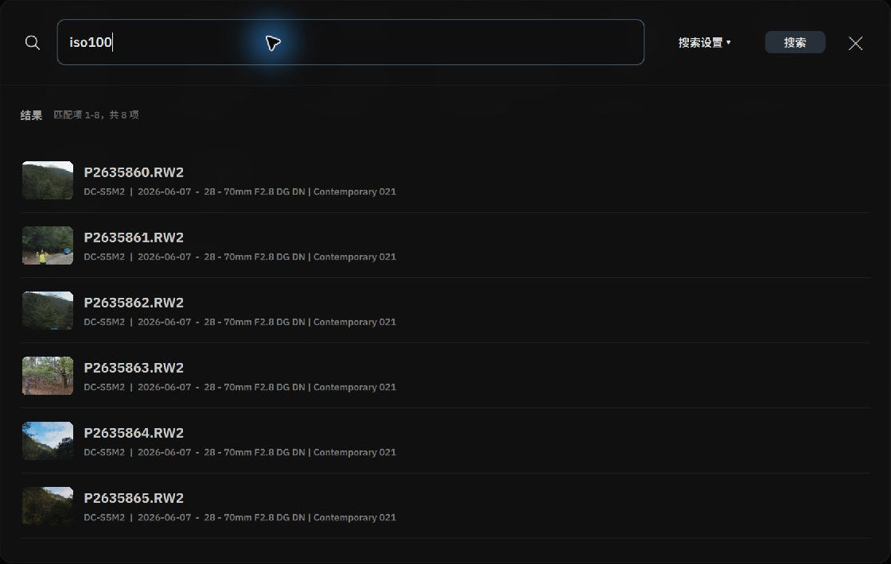
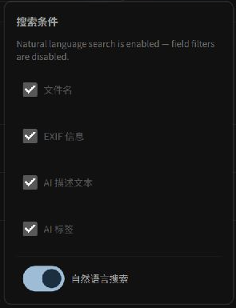

# AI Semantic & Structured Search

Alcedo Studio’s global search supports queries on fields such as EXIF metadata and natural language semantic search using a local CLIP model.

---

## Accessing Search & Configuring Criteria

Click `Search` in the left utility rail of the Library (or press `Ctrl+F` / `Cmd+F` on macOS) to summon the central search console.


*Global search results and metadata*

Click `Search settings ▾` in the upper-right corner of the search box to configure active search fields:
- **Filename**: Matches keywords within file names.
- **EXIF info**: Matches camera bodies, lenses, and exposure parameters.
- **AI description**: Matches saved AI description text.
- **AI tags**: Matches semantic content tags generated by on-device models.
- **Natural language search**: Dedicated AI toggle that routes queries directly into the local CLIP vector embedding space for meaning-based retrieval.

---

## Mode 1: Natural Language Semantic Search (Find by Visual Concept)


*Enabling natural language search to find photos using a text description*

With `Natural language search` checked, you do not need preexisting keywords. Simply describe what you remember about the scene:

```text
"golden retriever running along ocean surf"
"red vintage wooden cabin in snow"
"rainy city street reflecting neon lights"
"dramatic sunbeams breaking through misty forest canopy"
```

### Underlying Mechanics
When you press Enter or click Search, the local text encoder converts your query into a vector. The engine matches it against image embeddings in the catalog using cosine similarity and ranks the results by relevance.

:::note Local Search
Natural language search uses the active local model.
:::

---

## Mode 2: EXIF & Structured Parametric Syntax

When evaluating gear performance or reviewing shots captured under specific lighting, disable natural language search to use structured parametric syntax:

| Query Example | Syntax Logic & Scope |
| --- | --- |
| `2026-06-07` or `June 7` | Matches all frames captured on a specific date |
| `raw` or `dng` / `jpg` | Filters by original file format container |
| `iso800` or `iso100` | Matches images shot at a specific ISO sensitivity |
| `f/1.4` or `f/2.8` | Matches photos taken at a specific aperture |
| `35mm` or `85mm` | Filters by specific focal length |
| `iso800 f/2.8 35mm` | **Compound query**: Matches images satisfying all three criteria simultaneously |

---

## Mode 3: Fuzzy Metadata Matching

Entering terms such as "Nikon", "Iceland", or "Studio" performs a fuzzy search across the selected fields, including file names, EXIF metadata, and saved AI descriptions.

---

## Search Results & Viewport Navigation

1. **Suggestions**: When the search box is active without text, suggestions appear for recent cameras, lenses, and dates. Click a suggestion to apply it.
2. **Apply to Library**: Pressing Enter filters the main Library grid. An active `SEARCH FILTER` badge appears in the right Album inspector; click `x` on the badge to clear the filter.
3. **Locate a Photo**: Clicking a search result scrolls the library grid to the photo and highlights it.

For scripts and AI agent operations, see [Automation with alcedo-cli](../automation/cli.md).
