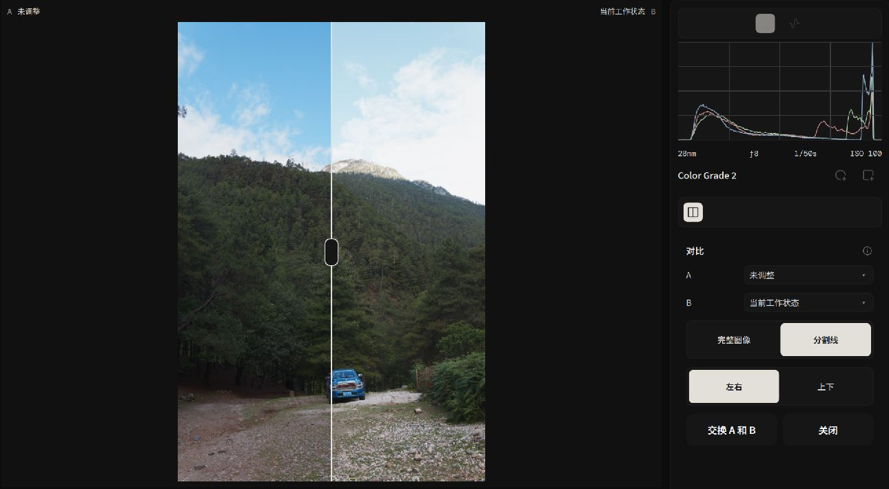
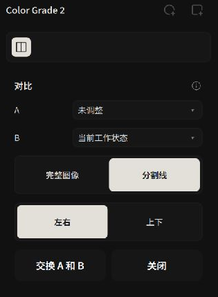

# Before & After: Version A/B Comparison

Alcedo Studio’s **A/B comparison** shows an image before and after adjustments or compares two versions of the same photo.

---

## Launching A/B Comparison & Assigning Sources

You can initiate comparison mode at any time from the main viewport toolbar or the Versions panel:

*Using the interactive split divider to evaluate before and after treatments*

### Two Primary Evaluation Scenarios
1. **Before vs. After**:
   - Click `Compare` in the canvas toolbar.
   - Side A automatically loads the "Unadjusted" raw baseline, while Side B displays your latest grade.
2. **Version A vs. Version B**:
   - Open the `Versions` drawer on the left and click `Compare`.
   - Use the Source A and Source B dropdowns to select any two saved version branches (for example, comparing "500T Warm Film" against "Tri-X High Contrast").

---

## Comparison Layouts & Interactive Controls

Entering comparison mode reveals the `Comparison Controls` inspector on the right:

*Switching flexibly between split divider, side-by-side, and stacked modes*

| Layout Mode | Display | Use |
| --- | --- | --- |
| **Divider** | Drag the divider to reveal either side of the image. | Compare details at the same position. |
| **Complete Images: Left / Right** | Side-by-side layout rendering two full, un-occluded frames. | Evaluating macro contrast balance, warm/cool color separation, and overall compositional mood. |
| **Complete Images: Top / Bottom** | Vertically stacked layout displaying two complete frames. | Examining horizon line balance and sky-to-ground contrast in panoramic or wide landscape crops. |
| **Swap A and B** | Swaps the positions of Source A and Source B. | Change the display order of the two sources. |

---

## Operational Mechanics & State Safeguards

- **During Comparison**: Parameter adjustments and version switching are temporarily unavailable.
- **Retry Mechanism**: If video memory pressure delays frame generation, click `Retry` to re-trigger the dual-render pipeline.
- **Return to Editing**: Click `Close` in the top bar to exit comparison mode.

---

For export instructions, see [Export Workflow: Batch Queue & Presets](../export/workflow.md).
