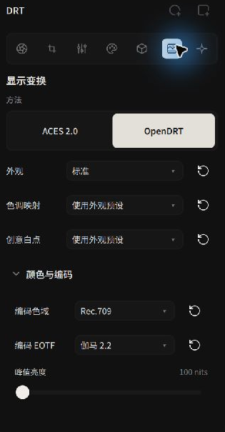
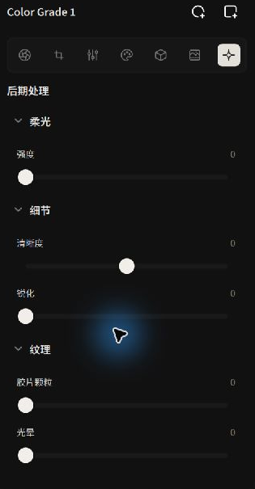

# Display Transform, HDR, Scopes & Post-Processing

The **Display Transform** converts the scene-linear image for display. **Post Processing** provides diffusion, clarity, sharpening, and other effects

---

## Display Transform: Mapping Scene Radiance to Display Devices

Modern camera sensors capture vast dynamic ranges (14–15+ stops of light), whereas typical desktop monitors display roughly 6–8 stops. Crude mathematical clamping causes skies to clip harshly into unnatural yellow-white blocks.

Alcedo Studio incorporates a dedicated **Display Rendering Transform (DRT)** that compresses expansive dynamic range while maintaining smooth highlight saturation rolloff and strict hue constancy:

*Display Transform configuration: Core mapping algorithm, encoding gamut, and EOTF*

This screenshot shows v0.3.3. The Film Print controls in this guide follow v0.3.5

### Core Transform Methods
- **ACES 2.0**: The latest standard from the Academy of Motion Picture Arts and Sciences. Features a redesigned tone scale that retains vibrant color purity in near-clipping highlights without the hue shifts observed in older ACES 1.x models.
- **OpenDRT**: An open-source display rendering transform favored in cinema workflows. Offers deep parameterization, allowing you to fine-tune highlight tonescale slopes, shadow flare compensation, highlight desaturation, and creative white points.
- **Film Print**: Select a negative or reversal film and simulate a print, negative scan, or slide on a light table. See [Film Simulation](./film-simulation.md)

### Encoding Gamut & Transfer Functions (EOTF)
Choose the encoding space and EOTF for the target display:

- **Rec.709**: BT.1886, Gamma 2.2, or sRGB
- **P3-D65**: Gamma 2.2, sRGB, or ST 2084 (PQ)
- **Rec.2020**: ST 2084 (PQ) or HLG

For HDR, select PQ or HLG and set peak luminance for the target display. Film Print outputs from paper, cinema print stocks, and reversal film use Rec.709 SDR. Negative Scan provides OpenDRT and encoding settings

---

## Real-Time GPU Scopes: Waveform & Histogram

Human vision easily adapts to ambient room lighting, creating subjective exposure errors. Relying on objective GPU scopes is essential for professional grading:

- **Histogram**:
  Located at the top of the right panel. Displays pixel frequency distribution across Red, Green, and Blue channels. Observe the outer edges to verify that shadows are not crushed to pure black and highlights retain unclipped headroom.
- **Waveform**:
  The horizontal axis maps directly to the horizontal pixel coordinates of the image, while the vertical axis indicates luminance levels from 0 to 100 IRE. This spatial alignment reveals the exact luminance of specific image zones (such as sunlight through clouds on the left or shadows on a face on the right), making it ideal for anchoring skin tones (typically between 40 and 70 IRE).

---

## Screen Post-Processing

Post Processing includes diffusion, clarity, sharpening, grain, and halation. With Film Print, adjust grain, format, and halation under **Display Transform → Style**

*Post Processing: Diffusion glow, clarity, sharpening, and halation*

| Module | Optical Simulation | Practical Guidelines & Visual Character |
| --- | --- | --- |
| **Diffusion** | Simulates cinema Black Pro-Mist filters or vintage lens optical flare. | Causes bright highlights (street lamps, direct sun edges) to bloom into a soft, dreamlike glow, gently easing clinical digital sharpness and softening skin textures. |
| **Clarity** | Adaptive midtone high-frequency contrast enhancement. | Enhances texture across architecture, rock surfaces, and fabrics; subtle negative values provide a gentle, natural skin smoothing effect. |
| **Sharpening** | High-frequency edge convolution with radius and threshold parameters. | Counteracts micro-blur from demosaicing interpolation, restoring crisp definition to eyes, eyelashes, and fine textures. |
| **Film Grain** | Adjusts grain and format. | Use the Post Processing controls with ACES 2.0 or OpenDRT. |
| **Halation** | Adjusts the red glow around bright lights. | Use the Post Processing controls with ACES 2.0 or OpenDRT. |

---

You now understand the complete darkroom color pipeline! Continue to [A/B Comparison](./comparison.md) to evaluate your adjustments against baseline references.
