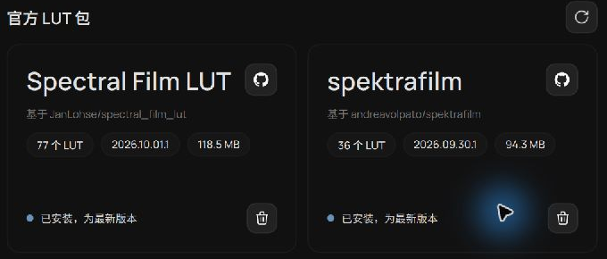
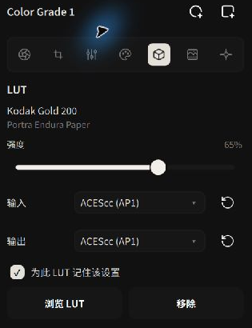
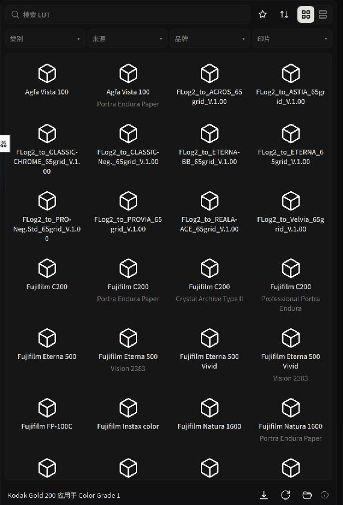

# 3D LUT Library, Film Emulation & Color Space Encodings

3D LUTs apply color transforms in a grading node. Alcedo Studio supports official LUT packages and imported `.cube` files, with controls for input encoding, output encoding, and strength

In v0.3.5, **Display Transform → Film Print** also offers film, print material, and scan settings. See [Film Simulation](./film-simulation.md)

---

## Official Film Packages & Custom Library Management

Official film simulation LUT packages can be downloaded in Settings. Their signatures are checked during installation:


*Official Film Simulation Package Manager in Preferences*

### 1. Downloading Official Film Packages
1. Navigate to `Settings → LUTs`.
2. Select a package from `Official LUT Packages`, such as Kodak Portra, Fujifilm Pro/Superia, CineStill, Kodachrome, or Tri-X.
3. Click `Download`. The engine downloads, verifies signatures, and installs the package in the background.
4. Once deployed, the status updates to `Installed`. Updates and repairs can be performed directly from this panel.

### 2. Importing Custom `.cube` LUTs
To use your own commercial or custom grading `.cube` files:
1. Under `Settings → LUTs`, locate the current `LUT library path`.
2. Click `Open in File Explorer` (or `Open in Finder` on macOS) to reveal the custom LUT directory.
3. Drop your `.cube` files or folders into the directory and click `Refresh`. Your custom LUTs will immediately appear under the `User` category in the browser.

---

## LUT Input & Output Color Space Encodings

LUTs may require specific input and output encodings. A mismatch can produce unexpected brightness or color. Each grading node provides **Input Encoding** and **Output Encoding** settings:

```text
[ Scene Linear Color (ACEScg) ]
             │
             ▼
[ 1. Input Color Transform ] ──▶ Converts scene data to the color space expected by the LUT (e.g. ARRI LogC3, Sony S-Log3, ACEScc)
             │
             ▼
[ 2. 3D LUT Transform ] ───────▶ Applies the color transform defined by the LUT
             │
             ▼
[ 3. Output Color Transform ] ─▶ Transforms the LUT's output back into the ACES pipeline
             │
             ▼
[ Downstream Grading & Display Transform ]
```


*Configuring exact Input and Output Color Space Encodings*

### Recommended Encodings Guide
- **Official Film Simulation Packages**: Tailored specifically for Alcedo Studio's linear pipeline; default to **ACEScc** for both input and output.
- **Cinema Camera Log LUTs (ARRI LogC3, Sony S-Log3, Canon Log 2)**:
  - **Input Encoding**: Set to the corresponding camera Log curve (e.g. `ARRI LogC3`).
  - **Output Encoding**: Choose the encoding specified by the LUT's documentation.
- **Other LUTs**: Choose the input and output encodings specified by the LUT's documentation. The two encodings may differ.
- **Remember for this LUT**:
  Checking this box saves the input/output color encoding pairing in the local catalog. Whenever this LUT is selected in the future, the correct color transformations are applied automatically.

:::caution Strength Cannot Mask Encoding Mismatches
If applying a LUT produces unexpected contrast, check the required input and output encodings before adjusting Strength.
:::

---

## Browsing, Applying & Blending Strength

In the Editor, open the `LUTs` drawer from the left tool rail:


*Visual LUT Browser: Category filtering, search, and thumbnail previews*

1. **Targeted Search**:
   - Filter by Category (Black & White, Color Negative, Color Reversal, Motion Picture), Source, or Brand.
   - Enter keywords (such as "Portra 400" or "5207") in the search bar.
   - Click the star icon to pin frequently used LUTs to your favorites.
2. **Apply to Node**:
   - Verify the desired grading node is selected, then click a LUT in the grid to immediately apply it to the canvas; clicking the active item unbinds it.
3. **Strength Blending**:
   - Adjust the **Strength** slider (0%–100%) in the right panel to linearly blend the results before and after the LUT.

---

For display output and post-processing, see [Display Transform, HDR & Post-Processing](./display-and-effects.md).
