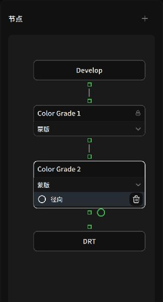
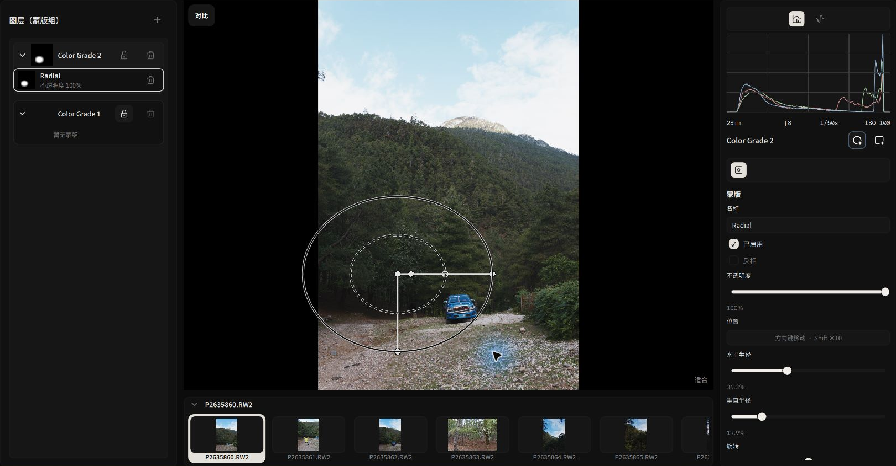
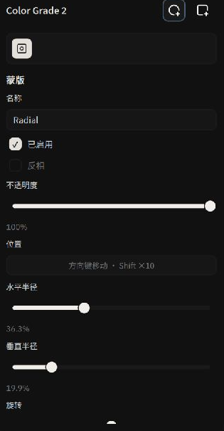

# Grading Nodes, Layers & Local Masks

Alcedo Studio uses a **node-based color pipeline** and **mask groups**. You can use multiple grading nodes and limit each node's adjustments with masks.

---

## Node Processing Order

Grading nodes form a sequential processing chain, for example:

```text
[ Input Decoding (RAW/Raster) ] 
       │ Scene-Referred Linear Color Stream (ACEScg)
       ▼
[ Develop Base Node ] ────────────── (Establishes global exposure, sensor white balance, and base dynamic range)
       │
[ Color Grade 1: Subject Pop ] ──── (Radial Mask: Focuses on facial tones, lifts exposure, refines specular contrast)
       │
[ Color Grade 2: Sky Burn ] ─────── (Linear Gradient Mask: Compresses overexposed sky clouds, infuses rich deep blue)
       │
[ Color Grade 3: Global Film Grade ] (Applies 3D LUT film simulation and Lift/Gamma/Gain split toning across the composite)
       │
[ Display Transform ] ────────────── (Maps scene linear values into target display gamut via ACES 2.0 / OpenDRT)
       │
[ Post Processing ] ──────────────── (Applies screen-space diffusion glow, organic film grain, and halation)
```

Each **Color Grade node** has its own `Tone`, `Look`, `LUT`, and `Mask` settings.

---

## Dual Perspectives: Nodes Graph & Mask Groups

The left tool rail provides two views:


*Nodes View: Visualizing the linear topology from raw input to calibrated display*

### 1. Nodes Topology Graph
- **Add Color Grade**: Click `Add Color Grade` to insert a new grading stage into the chain.
- **Custom Naming**: Name nodes by intent (e.g., "Base Balance", "Subject Key Light", "Cool Ambience").
- **Target Selection**: Clicking a node in the canvas highlights it; the right adjustment stack updates its title to confirm that all sliders modify that specific node.

### 2. Layers & Mask Groups View
If you prefer a layer-based workflow reminiscent of Photoshop or Capture One, open the `Mask Groups` drawer:
- Each grading node is displayed as a layer card with an attached mask preview and an opacity slider.
- Drag layers vertically to reorder operations and observe how sequential blend contexts affect your final render.

:::tip Base Node Protection Mechanism
The root grading node holds the global baseline for the entire image. Under `Settings → Default Behavior`, the recommended option is "Create a new layer, then draw". When you begin drawing a mask, the application automatically provisions an isolated local grading layer, preventing your base exposure from being accidentally restricted inside a local circle.
:::

---

## Local Masking Tools & Interactive Canvas Handles

When you attach a mask to a grading node, the contextual **Mask** inspector slides out automatically while interactive geometric handles appear across the canvas.


*Manipulating radial mask feathering and rotation directly on canvas*

### 1. Radial Mask
Use a radial mask to adjust an elliptical area of the image:


*Fine-tuning radial mask geometry and inversion*

1. **Draw the Mask**: With a grading node active, add a radial mask and drag across your subject to create an ellipse.
2. **Interactive Canvas Handles**:
   - **Center Anchor**: Drag to reposition (arrow keys provide pixel-level nudge; hold `Shift` for larger steps).
   - **Dual Feather Rings**: The inner ring marks the 100% influence area; the outer ring marks the edge of the falloff. Adjust the gap between them to change the transition width.
   - **Rotation Handle**: Tilt the major and minor axes to align with jawlines or diagonal light rays.
3. **Inversion & Opacity**:
   - Check `Invert` to reverse the mask's affected area.
   - `Opacity`: Adjusts overall mask influence between 0% and 100%.

### 2. Linear Gradient Mask: Balancing Sky and Earth
A linear gradient mask can be used to adjust the sky and foreground separately, for example:

1. **Draw the Gradient**: Add a linear gradient mask and drag from the upper edge of the frame downward toward the horizon.
2. **Transition Shaping**:
   - Rotate the gradient axis to match sloping mountain ridges or ocean horizons.
   - Adjust **Transition Width** to control the extent of the mask's gradient.
3. **Adjust the Node**: Change `Exposure`, `Highlights`, and white balance in the node, then check the mask's coverage in the image.

---

For the adjustment controls within a node, see [Tone, Curves & Color Grading](./tone-and-color.md).
