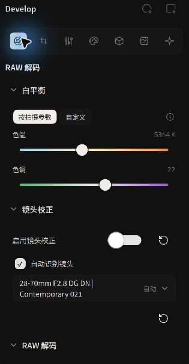
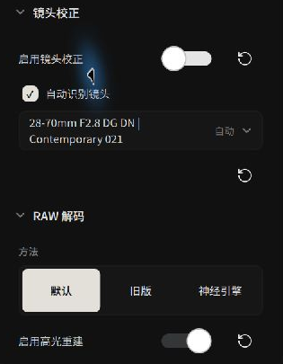
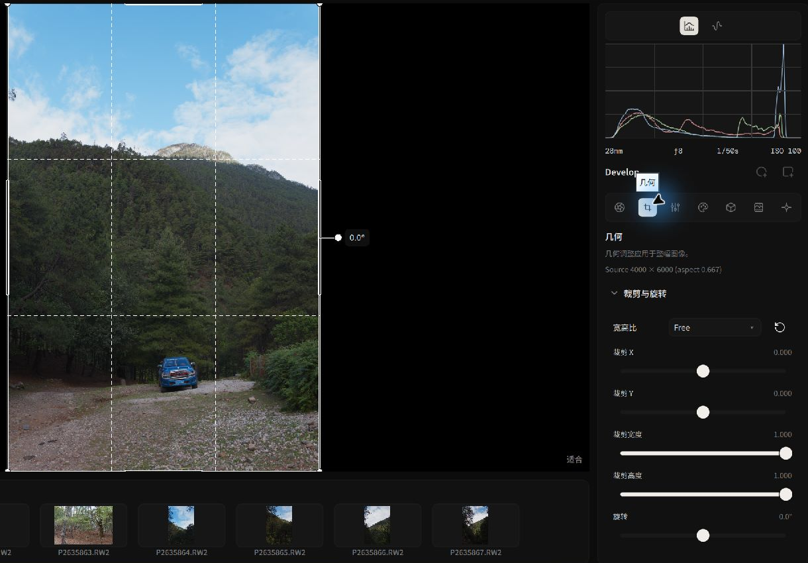

# Input Decoding, Color Profiles & Geometry

This page covers **RAW decoding, raster input color**, and **crop and rotation**.

---

## RAW Photography: Sensor-Level White Balance & Demosaicing

RAW data from cameras with a color filter array (CFA) requires decoding and demosaicing to produce a color image.

*RAW Decode Console: Camera White Balance & Optical Calibration*

### 1. Camera White Balance
- **As Shot**: The application reads the camera's recorded white balance information and applies it during RAW decoding.
- **Look White Balance**: RAW white balance is applied during decoding; the CAT02 white balance in the [Look panel](../editing/tone-and-color.md) operates within a grading node.

### 2. Demosaicing Algorithms
Demosaicing determines the sharpness, clarity, and artifact resistance when interpolating full three-channel color from the mosaic array:
- **RCD (Ratio-based Corrected Demosaicing)**: The default algorithm for Bayer sensors.
- **Neural Engine**: A GPU-accelerated neural network for Bayer and Fujifilm X-Trans sensor data.
- **X-Trans**: Uses a neural network branch for Fujifilm’s 6×6 filter array.

### 3. Highlight Reconstruction
When some color channels clip, check `Enable Highlight Reconstruction` to estimate missing data using information from unclipped channels. Results depend on the source file and the extent of clipping.

### 4. Lens Calibration
Alcedo Studio features deep integration with the Lensfun optical database:
- **Automatic Camera & Lens Matching**: Automatically detects camera mounts and specific lens profiles from EXIF metadata.
- **Optical Corrections**: Uses lens profiles to correct distortion, vignetting, and lateral chromatic aberration.
- **Manual Override**: For manual, vintage, or adapted lenses without full EXIF tags, search and select your lens profile manually from the picker.

---

## Raster Input Color Management

Alcedo Studio also supports JPEG, TIFF, PNG, and OpenEXR files. When opening a non-RAW file, the panel presents `Input Color / Input Profile`:

*Automatic Color Space Detection for Non-RAW Files*

- **Auto (metadata)**: Default setting. The engine parses embedded ICC color profiles, PNG chromaticity chunks, or OpenEXR color primaries.
- **Scene-Referred Conversion**: Whether the image is encoded in sRGB, Display P3, Adobe RGB, or Rec.2020, the engine maps it cleanly into the scene-referred ACES linear workspace. This allows raster files to benefit from node-based grading and ACES/OpenDRT display transforms.
- **HDR Raster Inputs**: 10-bit+ HEIF/TIFF images containing PQ / HLG curves or 16/32-bit floating-point OpenEXR images are automatically recognized as HDR inputs.

---

## Geometry: Crop & Rotation

Crop and rotation set the image framing and can be undone or adjusted again in the edit history.

*Composing with rule-of-thirds grid and boundary containment*

1. **Aspect Ratio**:
   - Standard presets include: `Original`, `1:1`, `4:5` (social portrait crop), `16:9`, `3:2`, and custom proportions.
   - Locking the ratio ensures that dragging crop handles maintains strict proportionality.
2. **Interactive Canvas Handles**:
   - An on-canvas rule-of-thirds grid assists in compositional balancing.
   - Drag corner and edge handles directly on the canvas, or enter exact pixel coordinates in the panel.
3. **Horizon Leveling & Rotation**:
   - Drag the rotation slider to level uneven horizons.
   - **Boundary Containment Algorithm**: As you rotate the canvas, Alcedo Studio dynamically scales the crop rectangle so it remains strictly enclosed within valid sensor pixels, **preventing black rotated corners or artificial pixel extension**.
4. **Reset**:
   - Click `Reset crop and rotation` at any time to return to the full uncropped frame.

---

For nodes and masks, see [Grading Nodes, Layers & Masks](./nodes-and-masks.md).
