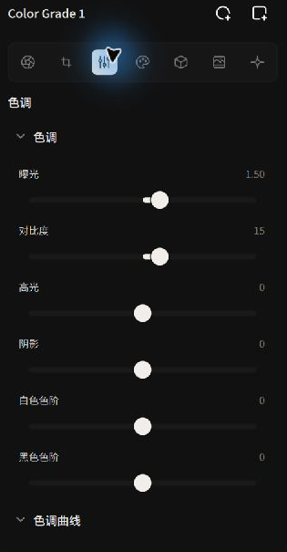
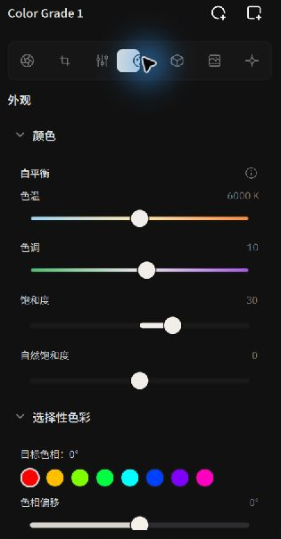

# Tone, Curves & Color Grading

Alcedo Studio’s grading pipeline uses a **scene-referred, wide-gamut linear color space (ACEScg)**. This page covers tone, white balance, saturation, selective color, and color wheels.

---

## Base Tone: Linear Exposure & Dynamic Range

Under the active grading node, open the `Tone` panel. The controls follow a photographic progression from global illumination to localized contrast:


*Sculpting light and shadow with physical exposure and bilateral tone mapping*

| Control | Physics & Algorithm Mechanics | Practical Tuning Guidelines |
| --- | --- | --- |
| **Exposure** | Scaled in real photographic exposure values (EV / stops), applying a linear `2^(ΔEV)` multiplier to scene radiance. | Establish global scene brightness first while monitoring highlight headroom on the histogram. |
| **Contrast** | Adjusts contrast around 18% middle gray ($0.18$), using a Hue Constancy algorithm. | Adjust overall contrast as needed. |
| **Highlights** | Compresses bright dynamic range via edge-preserving bilateral filtering. | Adjust bright areas such as skies and reflections, and check edge transitions. |
| **Shadows** | Localized gradient lifting across low-key regions. | Reveals backlit facial details and architectural shadows while preserving a clean black floor on the waveform. |
| **Whites / Blacks** | Adjusts white and black levels in the image. | Adjust highlights and shadows while watching the histogram. |
| **Tone Curve** | Interactive multi-point cubic spline curve. | Left-click to add and drag points; right-click to delete; double-click the curve area to reset. Ideal for fine-tuning S-curve contrast. |

:::tip Slider Reset
Double-clicking any slider handle in the interface immediately resets the parameter to its default value.
:::

---

## Core Color Science: Two Distinct White Balances

`RAW Decode` and `Look` have separate white balance controls that operate at different stages:


*Applying CAT02 creative white balance and hue controls in the Look panel*

```text
[ RAW Camera White Balance ] ──▶ Adjusts channel gains during RAW decoding
[ CAT02 Look White Balance ] ──▶ Adjusts white balance in the grading node
```

1. **RAW Sensor White Balance (Camera WB)**:
   - **Pipeline Stage**: Operates prior to demosaicing interpolation.
   - **Method**: Applies white balance gains to color channels during decoding.
   - **Use**: Adjusts the white balance of the RAW image.
2. **Creative Look White Balance (Look WB)**:
   - **Pipeline Stage**: Operates inside the scene-referred linear grading node.
   - **Method**: Uses the **CAT02 (CIECAM02 Chromatic Adaptation Transform)** matrix to adjust color.
   - **Use**: Adjusts temperature and tint within the node, including masked adjustments to a subject or background. It is available for RAW and raster images (JPEG/TIFF).

---

## Saturation & Selective Color

In the `Look` panel, you can independently refine overall vibrance and isolate individual color ranges:

- **Vibrance**: Adjusts color saturation with a stronger effect on less saturated colors.
- **Saturation**: Linear chroma scaling across all color channels.

### 8-Hue Selective Color Isolation
Expand `Selective Color` to perform 3D geometric shifts across 8 primary hue families (Red, Orange, Yellow, Green, Cyan, Blue, Purple, Magenta):

1. **Target Hue**: Select the color family to manipulate (e.g. Green for foliage, Orange for portraits).
2. **Hue Shift**: Rotates the color direction (e.g. shifting dry yellow-green grass toward deep emerald, or golden sunsets toward rose peach).
3. **Lightness**: Modulates reflectance brightness of the isolated color (e.g. darkening blue skies for richer cloud separation).
4. **Chroma**: Independently boosts or desaturates purity for the selected color band.
5. **Hue Smoothness**: Adjusts the transition width into neighboring hues.

---

## Three-Way Color Wheels (Lift / Gamma / Gain)

The three wheels adjust color in different tonal ranges:

- **Lift (Shadows / Pedestal)**: Operates predominantly on dark tones and black levels. Typically pushed toward cool cyan-blue to ground shadows.
- **Gamma (Midtones / Power)**: Covers the majority of skin reflections and primary scene textures, establishing overall emotional warmth.
- **Gain (Highlights / Slope)**: Acts as a slope multiplier affecting specular highlights. Pushed toward warm golden tones to create classic complementary contrast.
- **Master Luminance Sliders**: Each color wheel includes a dedicated master luminance slider below the disc, allowing you to rebalance zonal brightness without disturbing your color vector. Click `Reset wheels` to return to default.

---

For LUT instructions, see [3D LUT Library & Color Space Encoding](./lut-library.md).
