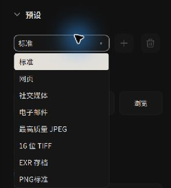
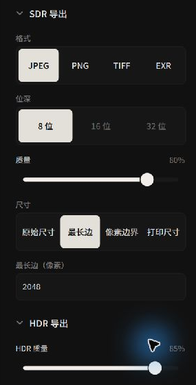
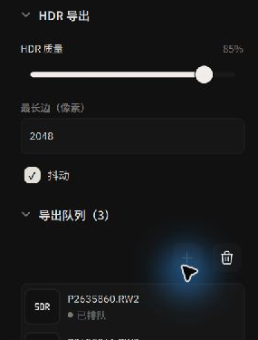
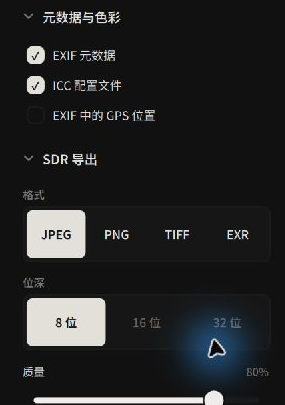

# Export Workflow: Batch Queue, Presets & Metadata

Alcedo Studio stores editing parameters in the project database. **Exporting** renders the edited result to an image file.

---

## Architecture Overview

The export queue processes photos in the background while you continue browsing or editing other photos:

```text
[ Select Photos in Library / Filmstrip ] ──▶ [ Add to Export Queue ]
                                                       │
[ Configure Export Presets / Naming / Resizing ] ◀─────┘
       │
       ▼
[ Background GPU Batch Concurrent Rendering ] ──▶ [ Final Master Deliverables (JPEG / 16-bit TIFF / Ultra HDR / OpenEXR) ]
```

---

## 1. Adding Photos to the Export Queue

1. Select one or more photos in the `Library` grid or the bottom `Filmstrip`.
2. Click `Add to Queue` at the top of the right inspector (or click the `+` icon on the export queue drawer).
3. Switch to the `Export` inspector tab to verify your queued items and source file count.
4. Clearing the queue only removes pending render jobs; it never modifies or deletes photos from your catalog.

---

## 2. Export Presets

The Export inspector provides presets for format, color profile, compression, and size:


*Selecting built-in presets or managing custom export profiles*

| Preset Name | Configuration & Specifications | Primary Use Case |
| --- | --- | --- |
| **Web** | JPEG Quality 80, Long Edge scaled to 2048px, sRGB color space, **GPS coordinates stripped automatically**. | Web blogs and social platforms; balances compression speed with location privacy. |
| **Social Media** | JPEG Quality 90, Bounds constrained to 1080 × 1350px (vertical orientation), sRGB, GPS stripped. | Instagram portrait streams and mobile social feeds. |
| **Email** | Lightweight JPEG Quality 75, Long Edge 1280px. | Rapid client preview proofs and email attachments. |
| **Maximum Quality JPEG** | Native resolution, JPEG Quality 100, EXIF and embedded ICC color profile. | Photo delivery and digital frame presentation. |
| **16-bit TIFF** | Native resolution, 16-bit depth, lossless ZIP compression. | Printing and print proofs. |
| **EXR Archive** | Native resolution, 16-bit half-float linear OpenEXR data. | Visual effects (VFX) compositing, 3D pipelines, and archival mastering. |

### Custom User Presets
When you modify the format, dimensions, or naming pattern, the preset dropdown displays `Custom`. Enter a name and click Save to store the preset in the application's local settings. Click the trash icon to delete a user preset.

---

## 3. Dynamic File Naming Patterns

File naming supports tokens. The **Example** preview shows the resulting filename so you can check the pattern before export:

```text
{date:yyyy-MM-dd}_{source}_{sequence:0001}
```

Supported dynamic tokens include:
- `{source}`: Original photo filename (excluding extension).
- `{date:yyyy-MM-dd}`: Formatted capture date (`yyyy` year, `MM` month, `dd` day, `HH` hour, etc.).
- `{sequence:0001}`: Zero-padded sequential increment (the number of zeros sets padding width).
- **Metadata Macros**: `{camera_model}` (camera body), `{lens}` (lens name), `{iso}`, `{aperture}`, `{shutter}`, `{focal_length}`, `{rating}` (star rating).

---

## 4. Output Formats, Bit Depth & Resampling


*Fine-tuning bit depth, compression algorithms, and physical resampling*

### Format & Bit Depth Matrix
- **JPEG**: 8-bit standard compression with fine-grained 1–100 quality slider.
- **PNG**: 8-bit and 16-bit support with configurable compression levels (0–9).
- **TIFF**: 8-bit, 16-bit, and 32-bit floating-point with `None`, `LZW`, or `ZIP` lossless compression.
- **OpenEXR**: Industry-standard 16-bit half-float and 32-bit full-float options.

### Sizing Modes
- **Original**: Exports at the full pixel dimensions of your active crop.
- **Long Edge**: Uniformly scales the longest edge to the specified pixel count while preserving aspect ratio.
- **Bounds**: Specifies maximum width and height bounds (e.g. 1920 × 1080); fits the entire image proportionally within the box without stretching.
- **Print**: Specify physical output measurements (mm / cm / in) and target print resolution (e.g. 300 DPI); the engine computes the corresponding pixel resolution automatically.

---

## 5. Ultra HDR Export

Alcedo Studio natively supports the **Ultra HDR JPEG** standard:


*Configuring Ultra HDR Gain Maps, HDR quality, and max edge scaling*

- **Gain Map**: An Ultra HDR JPEG contains an SDR image and a gain map. Compatible viewing software and an HDR display can use the gain map to show the HDR rendition; other viewers can display the SDR image.
- **Dedicated HDR Controls**: Tune HDR Quality, Dithering, and maximum HDR edge scaling (256–8192px) independently of SDR output rules.

---

## 6. Metadata, Color Profiles & Privacy Protection


*Independent GPS and EXIF controls*

- **EXIF metadata**: Toggles whether exposure parameters, camera bodies, and lens models are written into files.
- **ICC profile**: Embeds a color profile (e.g. sRGB or Display P3) for software that supports color management.
- **GPS location in EXIF**:  
  Use the separate toggle to control whether GPS location is written to the exported file. Other EXIF data depends on the EXIF setting.

---

## 7. Starting the Render Queue

1. Select your target **Destination** folder (optionally checking `Put in Subfolder`).
2. Click the blue `Export … Files` button.
3. Queue items transition through states: `Queued` → `Exporting` → `Done`.
4. If a file fails, check the displayed error. When export finishes, inspect the files in the destination folder.
