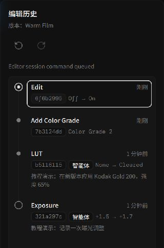
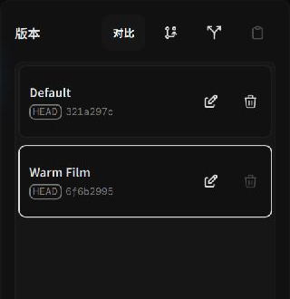

# Edit History, Version Branches & Selective Transfer

Alcedo Studio records edit history as **directed acyclic graph (DAG) commits and branches**. You can undo and redo operations and create multiple versions of a photo.

---

## History: Atomic Commits & Non-Destructive Undo

*Reviewing chronological commits and adjustment records*

### 1. Commit Lifecycle
- **Interactive Viewport Preview**: The viewport previews adjustments while you drag sliders.
- **Commit on Pointer Release**: Releasing the mouse pointer or concluding numeric input bundles the current modification into an atomic transaction commit in the DAG. Crop changes, mask edits, white balance tweaks, and LUT swaps all create discrete commits.
- **Non-Destructive Navigation**: Press `Ctrl+Z` (`Cmd+Z` on macOS) to undo, and `Ctrl+Shift+Z` / `Ctrl+Y` to redo. Clicking any past step in the `History` panel instantly restores the canvas viewport to that precise historical state.

### 2. Autonomous Agent & Automation Badges
Edits generated via `alcedo-cli` or AI companion agents are annotated in the history panel with distinct badges and rationale descriptions, making it easy to review or roll back automated modifications.

---

## Versions: Branching Creative Directions

**Versions** let you save multiple sets of adjustments for one photo:

*Managing multiple independent creative branches for a single photograph*

### Core Branching Workflows
- **Branch from current commit**:  
  Forks a new branch head from your current editing milestone. For example, after finishing base tone adjustments, branch off into "Warm Cinematic Film" while keeping another branch for "High-Contrast B&W".
- **Fork new version from root**:  
  Creates a clean branch directly from the unadjusted RAW baseline, ideal for starting over with a completely fresh concept without losing existing work.
- **Switching Versions**: Click a version name to check out that branch and update the viewport. Pending changes on the active branch are committed before switching.
- **Rename & Prune**:  
  Double-click version titles to rename them (e.g. "Client Preview", "Final Master Print"). The active branch is protected from accidental deletion; switch to another branch first before removing obsolete versions.

---

## Selective Adjustment Transfer (Copy & Paste)

Use **Selective Adjustment Transfer** to copy selected adjustments from one photo to others. Crop and exposure can also be selected, so check the selected modules before pasting.

*Selectively choosing parameters for transfer*

### How to Transfer Adjustments
1. **Copy Adjustments**:  
   Right-click the graded source photo in the Library or Filmstrip and choose `Copy Adjustments…`.
2. **Choose Source Version & Modules**:  
   In the configuration dialog, select the source Version and check only the parameters you want to transfer:
   - **Input & Geometry**: RAW camera white balance, demosaicing, lens calibration, crop, and rotation.
   - **Color Grade Nodes**: Tone (exposure, contrast, curves), Look (CAT02 creative WB, vibrance, color wheels), 3D LUT, and color space encoding rules.
   - **Global Transforms**: Display Transform (ACES 2.0 / OpenDRT) and Post Processing (diffusion, film grain, sharpening).
3. **Select Target Photos**:  
   Select one or more destination photos and right-click to choose `Paste Adjustments…`.
4. **Confirm & Execute**:  
   Verify the parameter selection and confirm. The transfer runs as an asynchronous background task.

### Versions After Pasting
- **Branch Creation**: Pasting creates a version branch for each target photo and retains its existing versions.
- **Unselected Parameters**: Parameters that are not selected retain their settings on the target photo. Check which settings each selected module includes before pasting.

---

For library management, see [Library & Asset Management](../library/import-and-organize.md).
