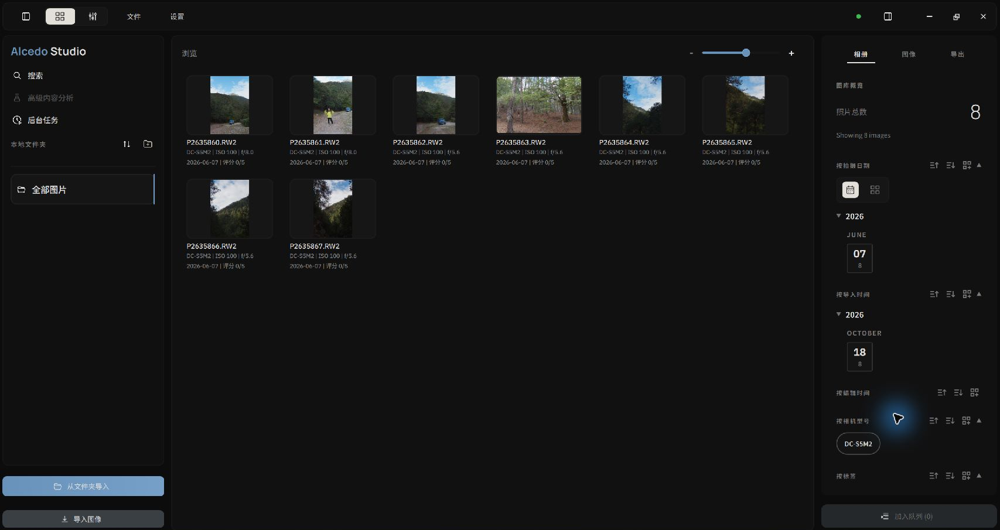

# Library: Import, Collections, Ratings & Multi-Dimensional Culling

Alcedo Studio’s Library uses an embedded **DuckDB database (the Sleeve engine)** to store photo references, metadata, and edit information.

---

## Importing Photos: Fine-Grained Controls & Recursive Scanning

Alcedo Studio provides two flexible import pathways to accommodate diverse shooting workflows:

```text
[ Disk Source Files ] ──┬──▶ [ Import Images (Direct selection) ] ─────────┐
                        └──▶ [ Import From Folder (Recursive + Filtering) ] ┴─▶ [ DuckDB Metadata Catalog & Thumbnail Cache ]
```

:::important Source Files and Memory Cards
When you import photos, Alcedo Studio records the **absolute path** of each source file in the `.alcd` project. It does not copy, move, or modify the photos.

Before importing, copy photos from the memory card to your computer or another storage device where you plan to keep them. If you import directly from a memory card, reading the source files may be limited by the I/O performance of the card and reader. If you remove the card or its mount path changes, the project cannot find the source files at their original paths.
:::

### 1. Import Images
Click `Import Images` in the left panel to launch the system file dialog. Ideal for bringing in single photographs or a small preselected batch.

### 2. Import From Folder
Importing from a folder scans the selected folder and its subfolders:
1. Select the root directory. The engine scans the folder and all nested subdirectories.
2. An import confirmation dialog aggregates files by their genuine format:
   - **RAW**: Camera raw files (Sony `.ARW`, Canon `.CR2/.CR3`, Nikon `.NEF` including HE/HE*, Fujifilm `.RAF`, Leica / generic `.DNG`, etc.).
   - **Raster Images**: JPEG, TIFF (8/16/32-bit), PNG, and OpenEXR.
   - **Other Files**: Non-image assets are counted for visibility and automatically excluded.
3. **Format Filtering**: Check the formats you want to import. If the folder contains both RAW and JPEG files, you can select only RAW.
4. Click `Import … File(s)`. The engine concurrently extracts EXIF metadata and registers records into DuckDB. A circular progress ring monitors progress and supports smooth cancellation.

---

## Virtual Collections: Non-Destructive Asset Organization

Use the `Collections` panel in the left sidebar to group photographs by assignment, subject, or client:

- **Create & Manage**: Click `+` to add a new collection (e.g., "2026 Iceland Expedition", "Studio Portrait Portfolio").
- **Organize**: Select one or multiple thumbnails in the center grid and drag them onto a collection, or right-click and choose `Add to Collection`.
- **Safe Deletion Logic**:
  - **Remove from Collection**: Only detaches the virtual reference from that specific collection; the photo remains fully indexed in the catalog.
  - **Remove from Project**: Completely removes the photo’s edit history and index from the `.alcd` database, but **leaves the original file on disk completely intact**.

---

## Star Ratings & Culling

Use keyboard shortcuts or batch operations to rate photos:

- **Keyboard Culling**: With photos selected, press number keys `1` through `5` to assign star ratings; press `0` to clear ratings.
- **Batch Rating**: Hold `Shift` for range selection or press `Ctrl+A` (`Cmd+A` on macOS) to select all images in the active view and assign ratings in bulk.
- **Background Persistence**: All rating updates are committed asynchronously to the database without requiring manual project saves.

---

## Album Inspector: Filter, Sort & Group

The `Album` inspector on the right provides filtering, sorting, and grouping:


*Using the Album Inspector for multi-dimensional filtering and dynamic grouping*

### 1. Filter
The inspector automatically aggregates metadata across the active view. Click any attribute to apply real-time filtering:
- **Capture Date**: Click a year, month, or specific day (e.g. "2026-06-07").
- **Gear**: Filter by camera body (e.g. "Sony A1", "Nikon Z8") or specific focal length / lens model.
- **Ratings & Labels**: Show only 5-star selects, or isolate specific AI tags (e.g. "Architecture", "Sunset").
- **Compound Filters**: Combine criteria such as "Nikon Z8 + 50mm f/1.2 + 5 Stars". Active filter chips appear at the top and can be dismissed individually with `x`.

### 2. Sort: Tailored Timeline Navigation
Use the dropdown menu beside any field to change the sort metric and order (Ascending / Descending):
- **Capture Time**: Follows the chronological story recorded by camera hardware.
- **Last Edited Time**: Quickly surfaces images you graded recently.
- **Import Time** and **Rating**.

### 3. Group: Structured Collapsible Sections
Click `Group By` beside any metadata field to organize the thumbnail grid into collapsible, titled blocks:
- **Group by Edit Status**: Visually separates "Edited" from "Unedited" frames to ensure no shot is missed.
- **Group by Capture Date**: Neatly folds shoots by day or month with collapsible headers.

---

## Capture Time & Hardware Timezone Handling

Alcedo Studio reads the capture time recorded in EXIF without shifting it when the computer's time zone changes. Times from different cameras still depend on each camera's clock settings.

---

Double-click a photo to open the editor. For input and framing settings, see [Input Decoding & Geometry](../editing/raw-and-geometry.md).
